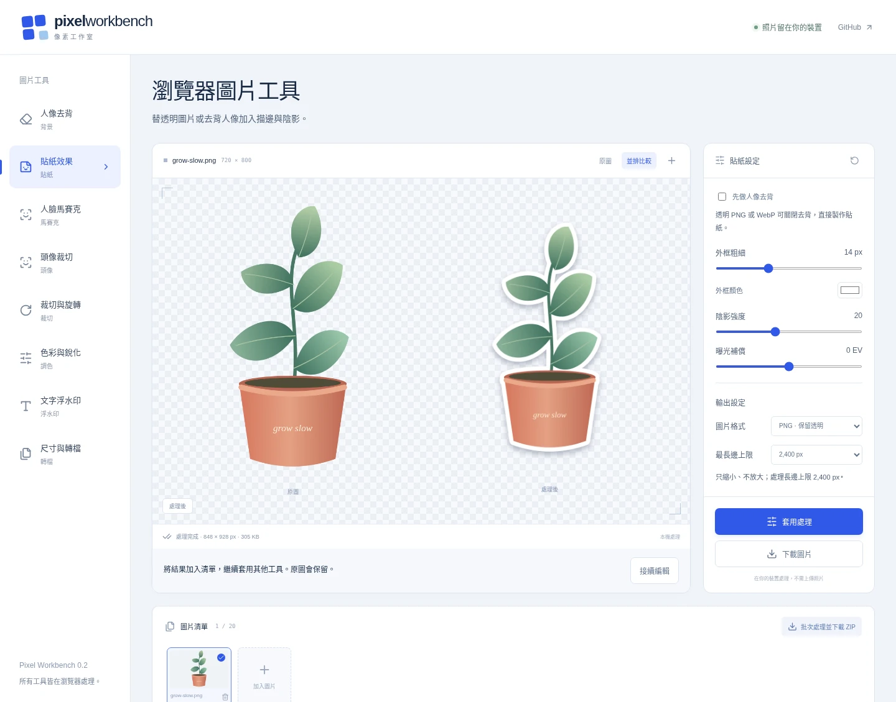
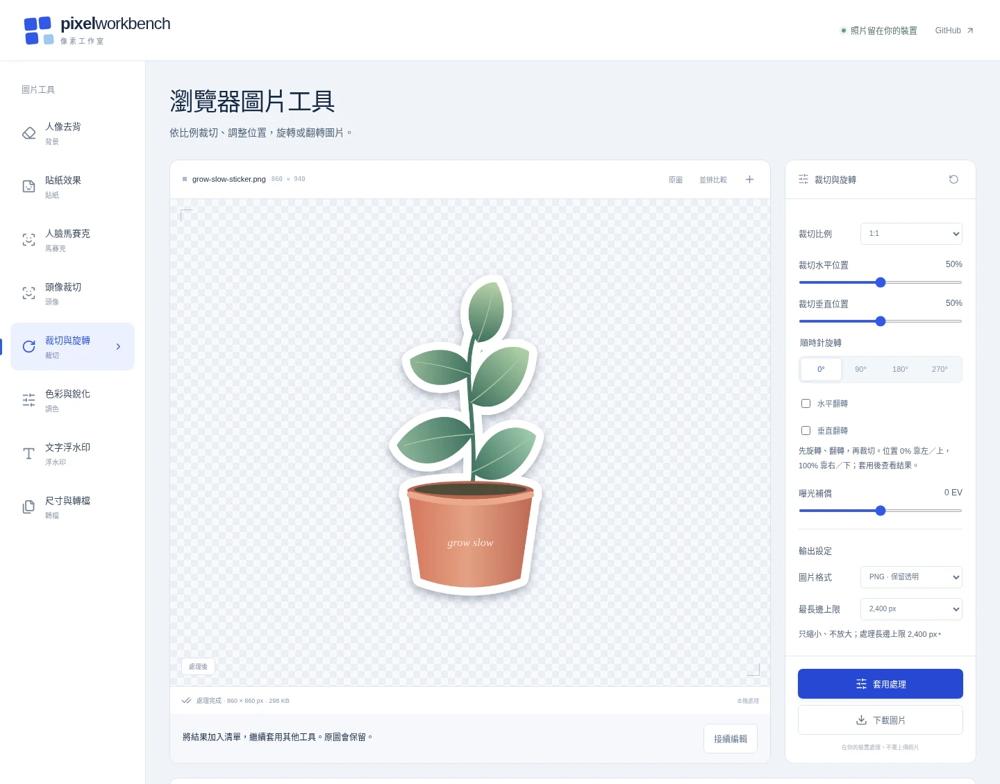

用 [Pixel Workbench](https://pixel-workbench-eta.vercel.app/) 內建的植物圖做一張透明貼紙，保留一份原比例，再試裁成正方形。只需要瀏覽器，先用範例就能走完流程。

## 1. 先看原圖和處理後的差異

開啟網站，在編輯預覽區點「先用範例做張貼紙」。等狀態出現「處理完成」，按「並排比較」。樣本已有透明背景，右側「先做人像去背」維持關閉。這張圖的重點是看新增的外框有沒有沿著輪廓走。

## 2. 改一個設定，再下載透明圖

1. 在「貼紙設定」把外框粗細調到 `20`，輸出格式用「PNG · 保留透明」。
2. 調整後會出現「設定已變更 · 請套用處理」。按「套用處理」。等下載按鈕恢復可用，再按「下載圖片」。
3. 用支援透明格紋的圖片工具打開 `grow-slow-sticker.png`。看輪廓外側能否透出格紋，並確認外框沒有被切到。部分圖片檢視器使用白色畫布，碰到這種情況可重新將檔案加進工作台，在格紋預覽內核對。

## 3. 把加框結果當作裁切輸入

按「接續編輯」。清單會有原圖和一張檔名含 `sticker` 的新圖，選取新圖。接著切到「裁切與旋轉」，裁切比例選 `1:1`，按「套用處理」。確認預覽顯示正方形，並檢查頂端葉片與底部外框有沒有被裁掉。如果要沿用裁切結果，確認後再按一次「接續編輯」。要接著做下一篇的兩張圖練習，保留目前兩張就好。

截圖來自 Pixel Workbench 正式站。下載的範例 PNG 已檢查有透明像素。

[下一篇：把兩張圖用同一個尺寸設定打包成 ZIP](../pixel-03-batch-webp-export/)
