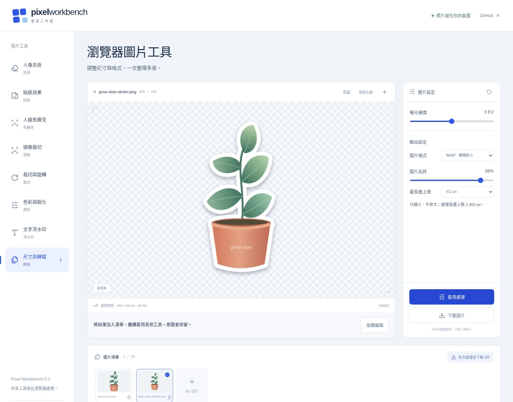

把清單裡兩張圖轉成 WebP，最長邊設成 512 px，最後解壓縮核對。可以沿用[前一篇](../pixel-02-transparent-sticker/)的原圖和貼紙，也可以到 [Pixel Workbench](https://pixel-workbench-eta.vercel.app/) 直接拖入兩張不同檔名的圖片。

## 1. 確認整批要處理的來源

看下方圖片清單，確認只有預計匯出的兩張。如果清單保留裁切前後各一份，先移除多出來的版本。批次會處理整個清單，單張預覽才只看目前選中的一張。

## 2. 先看一張縮圖的輸出

1. 在左側選「尺寸與轉檔」，將圖片格式選成「WebP · 體積較小」，最長邊上限選 `512 px`。
2. 選一張含透明邊緣的圖，按「套用處理」，看預覽的寬高和背景。短邊應等比例縮小。若原圖最長邊小於 512 px，維持原尺寸。
3. 若邊緣很細，先用「並排比較」判斷輸出有沒有糊掉。需要調整畫質就先重試單張。

## 3. 批次處理並檢查檔案

按「批次處理並下載 ZIP」。狀態應出現「批次完成」與實際打包張數。解壓縮後，逐張開啟，確認有兩個 `.webp`、沒有多的裁切版本、長邊至多 512 px。用支援透明的檢視器打開有貼紙外框的一張，確認背景仍透明。

本文用正式站的植物原圖和加框結果走過這條流程，並解開 ZIP 檢查兩個檔案都能解碼為 WebP。需要一次處理更多檔案時，先把同一套設定試在尺寸和透明度差異最大的一兩張上。
