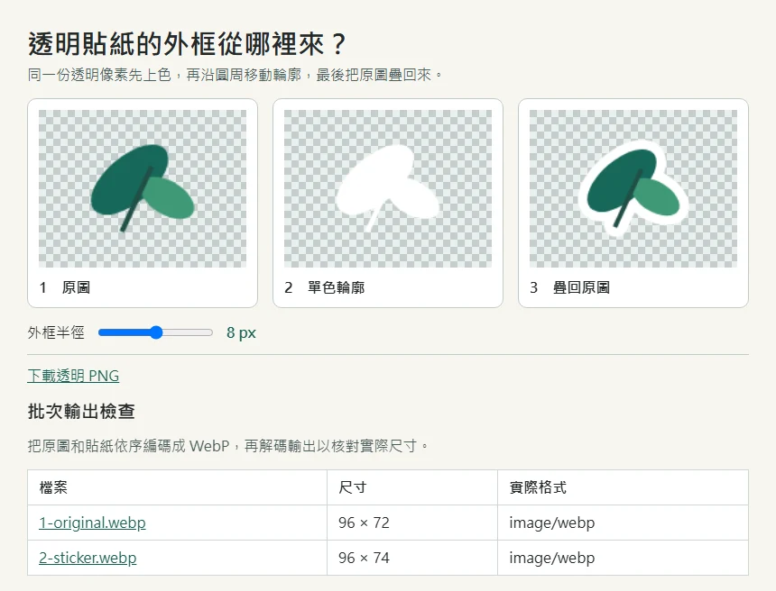
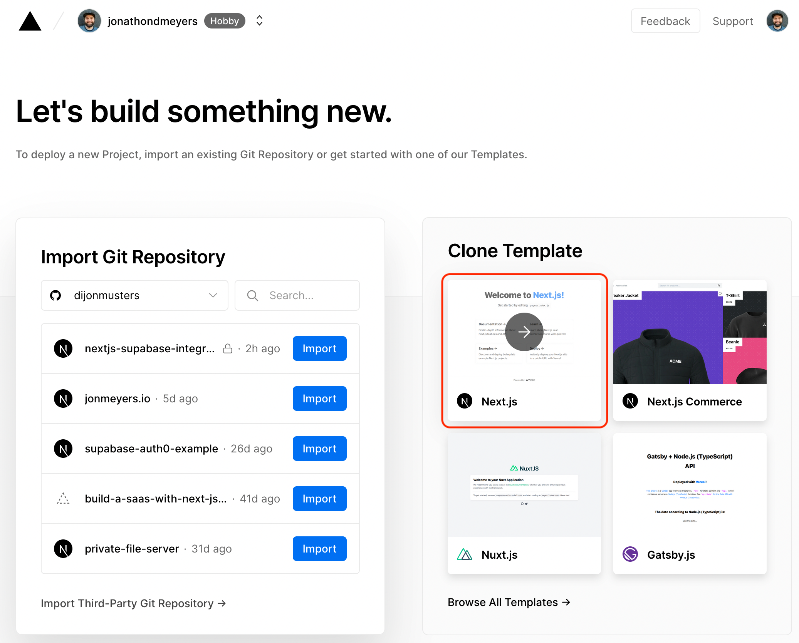

## 1. 讓兩個不同大小的來源使用同一個設定

開啟[批次版練習](../../downloads/series-labs/pixel-sticker.html?batch=1)，也可在上一課另存的 HTML 網址後加 `?batch=1`。外框保持 8 px。頁尾會列出原圖與貼紙各自的尺寸及實際 MIME，點檔名拿到真正的輸出檔。

編輯相同 HTML 的 `batch()`，把 `96 / Math.max(input.width, input.height)` 的上限改成 48。存檔並重新整理，應看到 **48 × 36、48 × 37**。公式用同一個 scale 乘寬高，並用 `Math.min(1, ...)` 保留小圖原尺寸。來源明明都是同一株植物，貼紙多了四周留白，因此輸出高度不同。

## 2. 編碼後再讀一次輸出

找到呼叫 `canvas.toBlob` 的地方。下面是相同做法攤開的版本，可取代產生 blob 的那行。接著程式用 `createImageBitmap(blob)` 重讀結果的寬高；表格的 MIME 取自 blob.type。

```js
const blob = await new Promise((resolve, reject) => {
  canvas.toBlob((file) => {
    if (file) resolve(file);
    else reject(new Error("無法編碼這張圖"));
  }, "image/webp", 0.85);
});
```

檢查表格的 MIME 是 `image/webp`。只改副檔名會讓檔案內容與名稱不符。看完後打開上一課 clone 的完整 repo；練習頁逐張下載，完整產品則把編碼結果收進 ZIP。

## 3. 寫一個會抓到同名覆蓋的測試

開 `src/core/files.test.ts`，在已有的 describe 區塊加入下列案例。相同來源檔名可能來自不同資料夾，索引要一路保留到 ZIP entry。測試使用檔案已匯入的 `DEFAULT_SETTINGS`、`outputName` 與舊有 Vitest 函式。

```ts
it("相同來源名稱寫成兩個有順序的 WebP entry", () => {
  const settings = { ...DEFAULT_SETTINGS, tool: "export", format: "image/webp" } as const;
  expect(outputName("葉子.png", settings, 0)).toBe("01-葉子-export.webp");
  expect(outputName("葉子.png", settings, 1)).toBe("02-葉子-export.webp");
});
```

執行 `npx vitest run src/core/files.test.ts`。接著開 `src/core/files.ts` 找 `archiveResults()`。它先等 `process(sources[index])` 完成，取得 Blob 的 bytes，接著 `zip.add(entry)`、`entry.push(bytes, true)`，所有圖完成後才 `zip.end()`。打包後的 chunks 仍保存在記憶體，逐張處理只降低同時解碼多張大圖的壓力。[批次處理實作](https://github.com/ntustRay/pixel-workbench/blob/main/src/core/files.ts)

執行 `npm run dev`，用兩張圖選 WebP 與同一尺寸上限，按批次匯出。解開 ZIP，確認有不同序號的兩個實際檔案，選其中之一檢查尺寸。若只有一張，先查傳入的 sources 與 entry 名稱，再查 ZIP 結尾是否有送出。


## 4. 將 Vite 版本部署到 Vercel

1. 把公開 repo Fork 到自己的 GitHub，將逐張匯出或測試的修改提交到自己的分支。先在專案根目錄執行 `npm run build`，確認產生 `dist/`，再跑 `npm run preview`，在終端顯示的本機網址重做一次匯出。
2. 在 Vercel Dashboard 選 **Add New → Project → Import Git Repository**，授權並匯入自己的 Fork。選有 `package.json` 與 `vercel.json` 的根目錄，Framework 選 Vite，Node.js 選 24.x。
3. 核對 repo 的 `vercel.json` 對應 **Install Command = npm ci、Build Command = npm run build、Output Directory = dist**。保留內附的模型與 WASM 回應標頭，按 Deploy。此專案不需設定資料庫或 API key。
4. 部署 Ready 後點 Visit，確認正式網域能做一般貼紙和批次匯出。另測人像工具，Network 應能從 `/models/` 與 `/wasm/` 取回檔案。若模型請求回 200 卻不能載入，檢查內容是否意外回傳 HTML，及 build log 的資產下載雜湊檢查。



[官方介面截圖來源](https://github.com/supabase/supabase/blob/7e866ef83e89e35cdda45a6c98abd069d5fa1b2f/apps/docs/public/img/guides/integrations/vercel/clone-next-js-template.png)

[閱讀這條影像處理流程的總結](../pixel-04-browser-image-pipeline/)。
