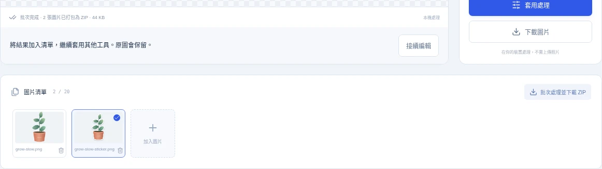

前兩篇分別把植物貼紙做成透明 PNG，再把兩張圖用同一組 WebP 設定打包。從單張切到批次之前，先確定設定真的能共用。全都是網頁預覽圖，可以統一限制長邊。有些是透明貼紙、另一些要用白底 JPEG，就需要分開處理。

## 長邊上限和來源尺寸各管一件事

一張 4,000 × 3,000 的圖，若用 8-bit RGBA 解碼，單份像素資料約 48 MB，還不含輸入檔、Canvas、輸出和 ZIP。這是用像素數乘以每像素 4 bytes 的估算。設定長邊 512 px 會減少輸出尺寸，讀取原圖時的開銷仍取決於實作和瀏覽器的解碼方式。

對要在瀏覽器處理很多圖片的工具，依序做能降低同時存在的解碼緩衝，但最後建立 ZIP 還會占用裝置資源。用 Worker 可以讓介面主執行緒處理使用者操作，仍要限制同時處理的檔案和可接受的輸入尺寸。

## 先在兩種邊界樣本上檢查設定

透明貼紙挑外框最細的一張，確認 alpha 與輪廓。普通照片挑解析度最高的一張，確認縮小後的細節和畫質。兩張都符合用途，就記下工具、格式、畫質與尺寸，把來源和已處理的檔案放在不同位置，再用同設定匯出整批。

若要繼續裁切或加字，先保留一份透明 PNG 當中間圖，交付時再決定 WebP 或 JPEG。這樣既能回到保留透明的版本，也避免一路用有損格式反覆重存。
