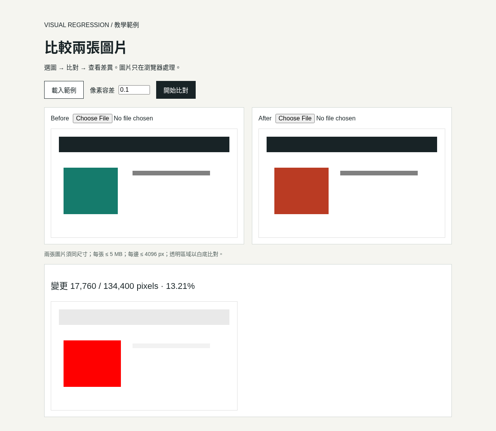
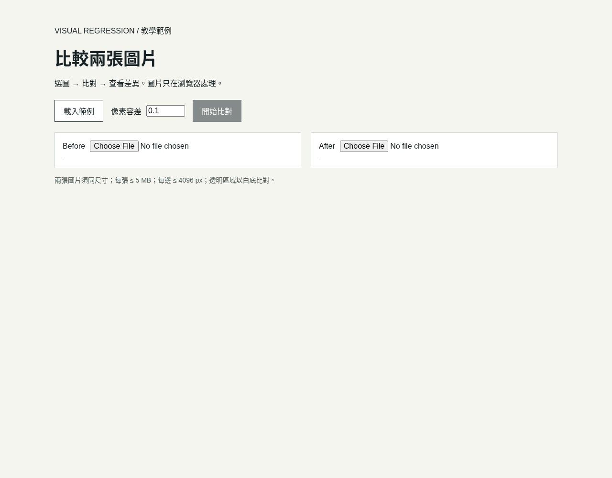
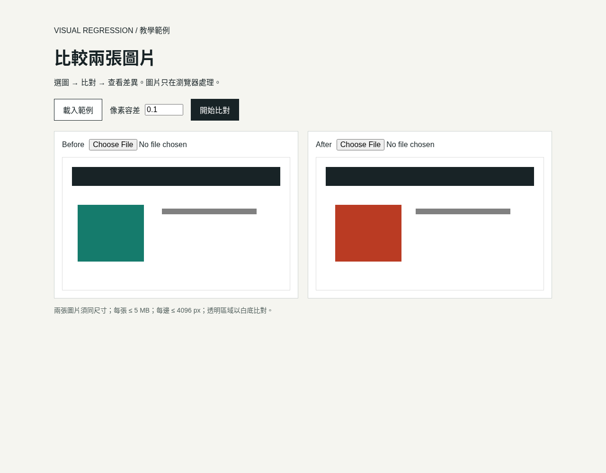
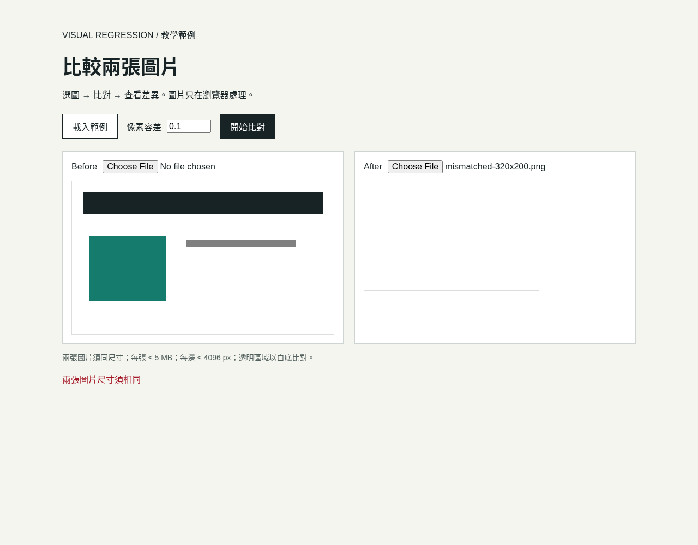

本篇會改一個純函式，讓同一段程式同時服務單元測試與選圖頁面。先看要交付的畫面，再用只有一個像素的測試理解數字怎麼來。



## 1. 啟動帶有選檔元件的骨架

準備 Node.js 24.x、Bun 1.4.4。[下載本系列實作附件](../../downloads/visual-regression-series.zip)，解壓後把 `code/01-local` 整個資料夾複製到工作目錄，命名為 `image-review`。保留其中的 `bun.lock`。開終端機執行：

```sh
cd image-review
bun install --frozen-lockfile
bun run dev
```

等終端顯示 Ready，開啟 `http://localhost:3000`。若這個埠已使用，請用終端實際印出的網址。首頁由 `src/app/page.tsx` 載入 `src/components/viewer.tsx`；選檔和 Canvas 都在後者的 client component 中執行。



## 2. 寫出讓測試變綠的四行

另開終端機。打開 `src/lib/diff.ts`，保留上半部的尺寸、RGBA 長度與容差檢查。將 `const rgba =` 起到函式最後一個 return 的區塊暫時改成 `throw new Error("尚未計算差異");`。執行 `bun test tests/diff.test.ts`，確認兩個合法輸入測試失敗。然後用下列程式取代剛加入的 throw。

```ts
const rgba = new Uint8ClampedArray(total * 4);
const changed = pixelmatch(a.rgba, b.rgba, rgba, a.width, a.height, {
  threshold,
  includeAA: false,
});
return { changed, total, rgba, width: a.width, height: a.height };
```

`total` 已在上方定義為寬乘高。每個像素需要四個位置，傳給 pixelmatch 的第三個參數用來寫入差異圖。函式的回傳值是差異像素數。重新執行剛才的測試，五項都應通過，其中黑白一像素的案例應得到 1，相同圖片應得到 0。

## 3. 讓固定小測試接到實際圖片

回首頁按「載入範例」，看到兩張縮圖後再按「開始比對」。沿 `src/lib/read-image.ts → run-compare.ts → diff.ts` 看一次：讀圖先合成白底，再取得 RGBA，最後傳入剛完成的純函式。百分比用 `changed / total * 100`，本組四捨五入到小數兩位是 13.21%。



改成同一張圖，重新比對應得到 0%。換入不同尺寸的圖則應看到下圖。若上一組 Diff 還留在畫面上，回 viewer 的換圖處檢查它是否清除舊結果。



## 4. 交給下一篇部署

停止開發伺服器，執行 `bun run check`。它依序檢查型別、Biome、測試和 production build。任一步失敗就先修第一個錯誤。完成後接[把同一個資料夾部署到 Vercel](../visual-regression-02-vercel-deploy/)。
