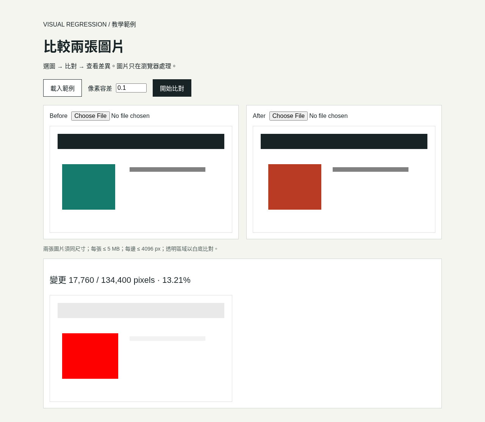
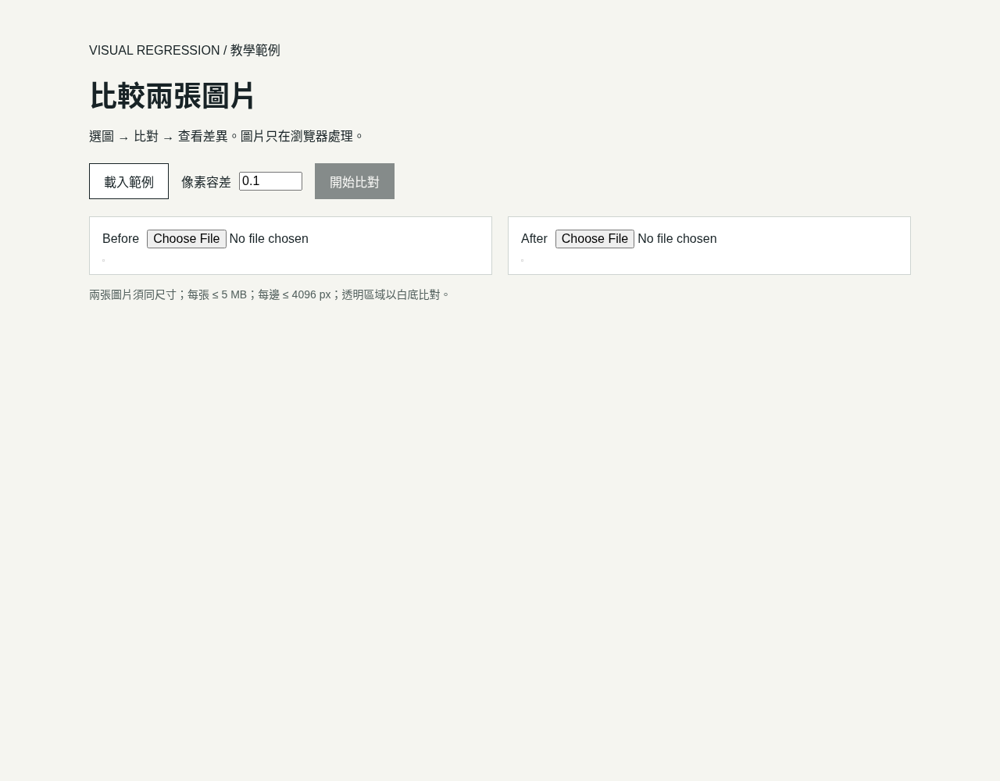
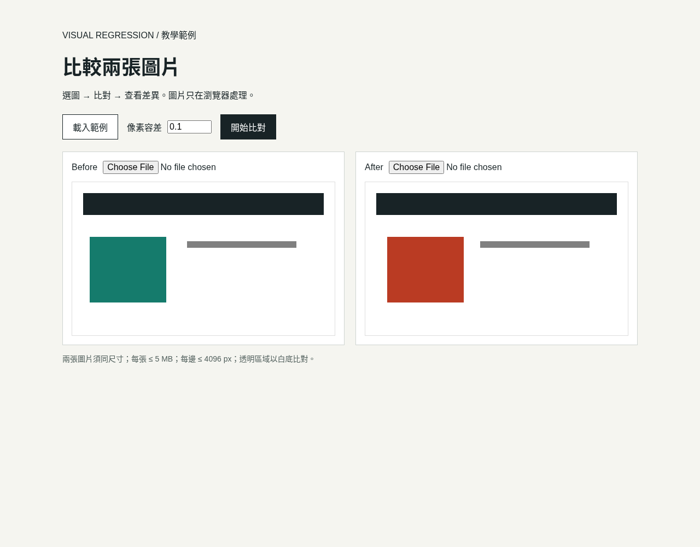
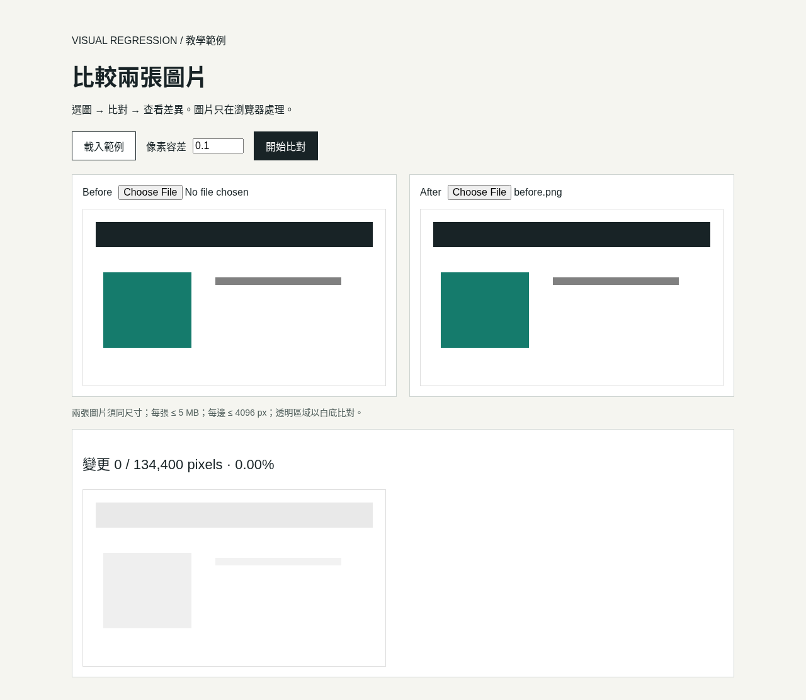
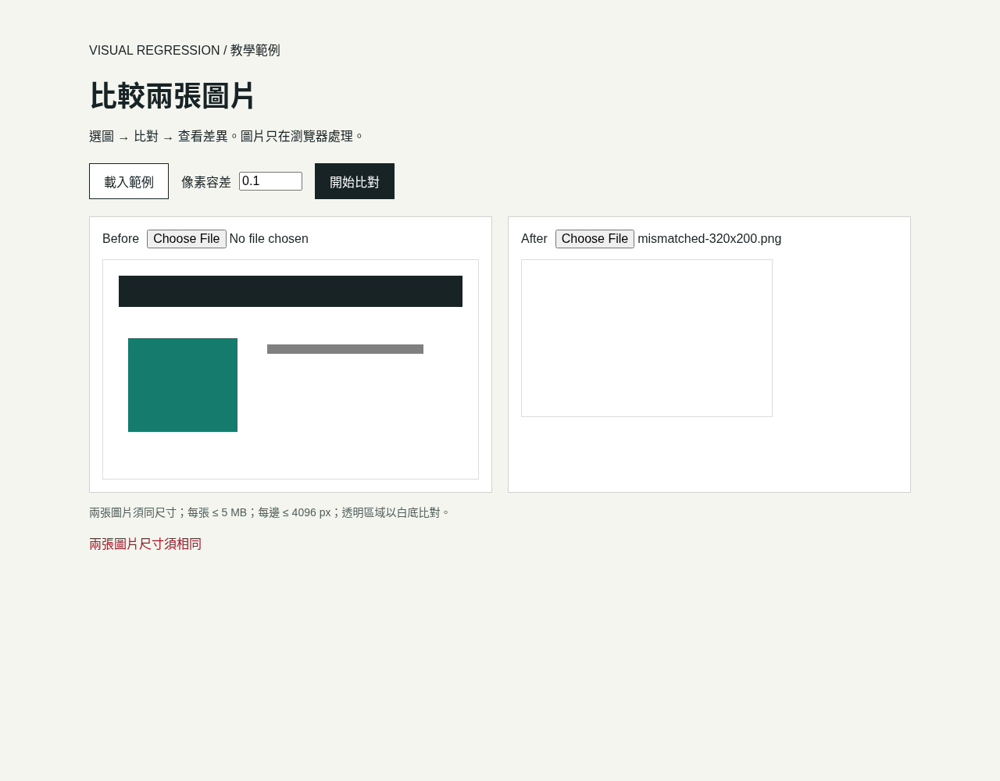
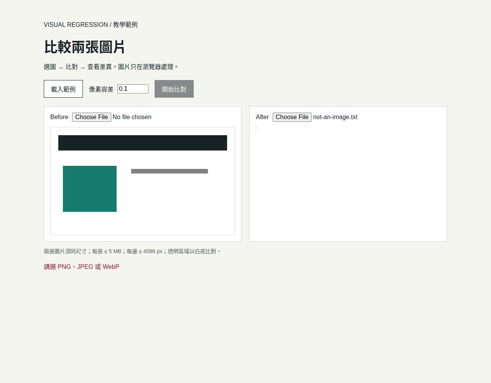

系列：[1 起步](../visual-regression-01-nextjs-bun-biome/) · [2 Vercel](../visual-regression-02-vercel-deploy/) · [3 Supabase](../visual-regression-03-supabase-private-storage/) · [4 Actions](../visual-regression-04-ci-cd/) · [5 Worker](../visual-regression-05-web-worker/) · [6 驗收](../visual-regression-06-correctness-and-access/)

[下載完整範例與圖片（ZIP）](../../downloads/visual-regression-series.zip) · [程式與驗證範圍](../../downloads/visual-regression-series/README.md)

完成畫面：Before、After、差異圖，以及變更像素與比例。

先準備 Node.js 24、Bun 1.4.4、編輯器及附件的 `code/01-local/`。本篇建立獨立教學專案 `image-review`，不使用私人 Framecheck 原始碼。

[](../../downloads/visual-regression-series/images/local/03-comparison-result.webp)

本次教學程式的完成畫面：三張圖與差異結果。（本次實拍；[操作紀錄](../../downloads/visual-regression-series/sources/local-captures.json)）

想先對照完成檔：複製附件 `code/01-local/` 到自己的新資料夾，執行 `bun install --frozen-lockfile`、`bun run dev`。以下仍逐步從空資料夾建立。

## 1. 開啟終端機，確認版本

```sh
node --version
bun --version
```

應看到 `v24.x.x`、`1.4.4`。找不到指令時，先完成 [Node.js](https://nodejs.org/en/download) 與 [Bun](https://bun.sh/docs/installation) 安裝，再重開終端機。


## 2. 建立 Next.js 專案

在要放專案的資料夾執行：

```sh
bunx create-next-app@16.4.2 image-review --ts --app --src-dir --biome --use-bun --no-tailwind --no-react-compiler --no-cache-components --import-alias "@/*" --yes
```

執行完成後，應出現 `image-review` 資料夾。


## 3. 進入專案，固定套件版本

```sh
cd image-review
bun add --exact next@16.4.2 react@19.3.0 react-dom@19.3.0 pixelmatch@8.0.0
bun add --dev --exact @biomejs/biome@2.6.2 @types/bun@1.4.4 @types/node@24.10.0 @types/react@19.2.2 @types/react-dom@19.2.2 typescript@5.9.3
```

開啟 `package.json`，確認 `dependencies` 有 `"pixelmatch": "8.0.0"`。

這組版本與附件完成檔一致。測試使用 Node 的 `node:test`，由 Bun 執行。


## 4. 檢查建立的檔案

用編輯器開啟 `image-review`。

左側應看見 `package.json`、`bun.lock`、`biome.json`、`src/app/`。

在 `package.json` 最外層加入或更新版本設定，保留其他欄位。Vercel 後續會讀取它們：

```json
"packageManager": "bun@1.4.4",
"engines": {
  "node": "24.x"
}
```


## 5. 放入比對核心

在編輯器建立 `src/lib/`，從附件 `code/01-local/src/lib/` 複製：

```text
diff.ts
read-image.ts
run-compare.ts
```

`diff.ts` 算差異；`read-image.ts` 讀圖並合成白底；`run-compare.ts` 呼叫核心。


## 6. 放入選圖元件

建立 `src/components/`，複製附件的 `viewer.tsx`。

完整路徑：`src/components/viewer.tsx`。第一行保留 `"use client"`，讓元件能處理選檔、Canvas 與 React state。


## 7. 換上教學頁面

從附件 `code/01-local/src/app/` 複製下列檔案到專案同名位置：

```text
page.tsx
layout.tsx
globals.css
```

只替換這個新建教學專案的檔案。不要覆蓋其他專案。


## 8. 放入範例圖片

將附件的 `code/01-local/public/samples/` 複製到專案的 `public/samples/`。

展開資料夾，確認圖片檔案在 `public/samples/` 內。


## 9. 加入檢查指令

開啟 `package.json`，在既有 `scripts` 物件內加入下列項目；保留 `dev`、`build`、`start`。

```json
"typecheck": "next typegen && tsc --noEmit",
"lint": "biome check .",
"test": "bun test tests",
"check": "bun run typecheck && bun run lint && bun run test && bun run build"
```

若已有同名項目，改值，不新增第二個。檢查前一項後面有逗號，最後一項後面沒有逗號。


## 10. 加入測試與檢查設定

建立 `tests/`，複製附件的 `code/01-local/tests/diff.test.ts`。

將附件 `code/01-local/biome.json`、`tsconfig.json` 複製到專案根目錄，取代同名設定。

`tsconfig.json` 已包含測試需要的：

```json
"allowImportingTsExtensions": true
```


## 11. 啟動網站

回到專案根目錄的終端機：

```sh
bun run dev
```

保留這個終端機。出現 Ready 後，用瀏覽器開啟 `http://localhost:3000`。

[](../../downloads/visual-regression-series/images/local/01-empty.webp)

首次開啟的教學首頁，還沒有載入圖片。（本次實拍；[操作紀錄](../../downloads/visual-regression-series/sources/local-captures.json)）

## 12. 載入範例

點「載入範例」。確認 Before、After 各出現一張色塊圖。

[](../../downloads/visual-regression-series/images/local/02-samples-loaded.webp)

點載入範例後，Before、After 都已出現。（本次實拍；[操作紀錄](../../downloads/visual-regression-series/sources/local-captures.json)）

## 13. 開始比對

點「開始比對」。確認差異圖、changed pixels 與百分比出現。

[](../../downloads/visual-regression-series/images/local/03-comparison-result.webp)

本組範例在容差 0.1 下得到 17,760／134,400 pixels，13.21%。這不是效能量測。（本次實拍；[操作紀錄](../../downloads/visual-regression-series/sources/local-captures.json)）

比例的計算是：

```ts
const ratio = changedPixels / (width * height);
const percent = `${(ratio * 100).toFixed(2)}%`;
```

`threshold: 0.1` 是單一像素的顏色容差，不代表整張圖片可以有 10% 差異。

## 14. 比對同一張圖

Before、After 都選同一個檔案，再點「開始比對」。

應看到 `0 pixels`、`0.00%`。這代表目前規則下沒有差異像素，不代表兩個檔案的位元組完全相同。

[](../../downloads/visual-regression-series/images/local/04-identical-images.webp)

兩邊選同一張範例圖，結果為零差異。（本次實拍；[操作紀錄](../../downloads/visual-regression-series/sources/local-captures.json)）

## 15. 試一次尺寸錯誤

選兩張尺寸不同的圖，再點「開始比對」。應顯示尺寸錯誤，不應產生結果。

換回同尺寸圖片，確認仍能操作。

[](../../downloads/visual-regression-series/images/local/05-dimension-error.webp)

尺寸不同時拒絕計算，顯示錯誤。（本次實拍；[操作紀錄](../../downloads/visual-regression-series/sources/local-captures.json)）

若選到非 PNG／JPEG／WebP 檔案，應明確拒絕：

[](../../downloads/visual-regression-series/images/local/06-file-type-error.webp)

不支援的檔案類型會顯示錯誤，不會繼續比對。（本次實拍；[操作紀錄](../../downloads/visual-regression-series/sources/local-captures.json)）

## 16. 改容差，再重新整理

改動容差，確認舊結果清空；重新比對後才出現新結果。

重新整理頁面，確認選圖與結果清空。本篇尚未保存資料。


## 17. 確認圖片沒有上傳

開啟瀏覽器 DevTools → Network，清除清單。選自己的教學圖片，再比對一次。

應沒有上傳選圖的請求。載入內建範例時，則會從本站 GET 圖片。


## 18. 執行四項檢查

回到啟動網站的終端機，按 `Ctrl+C`，再依序執行：

```sh
bun run typecheck
bun run lint
bun run test
bun run build
```

每個指令成功後才執行下一個。只有格式問題時，可執行 `bunx biome check --write .`，確認修改內容後重查。create-next-app 產生的 README 也可能需要這次格式修正。


四項通過後，接第二篇部署到 Vercel。附件這一階段已通過型別、Biome、5 項測試與完整 build；見[驗證紀錄](../../downloads/visual-regression-series/code/VERIFICATION.md)。

下一篇：[2 Vercel](../visual-regression-02-vercel-deploy/)。
