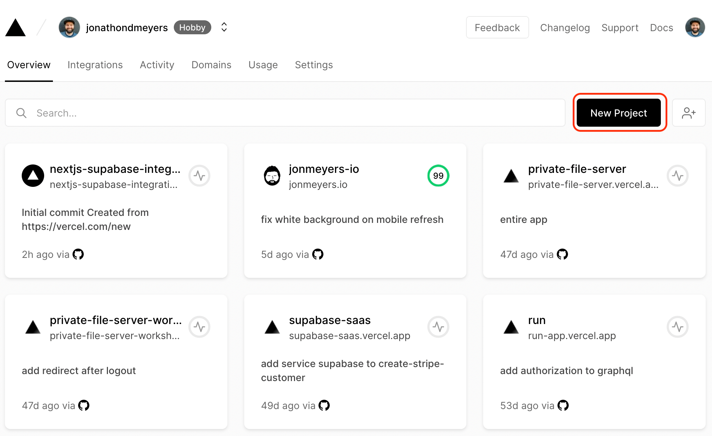
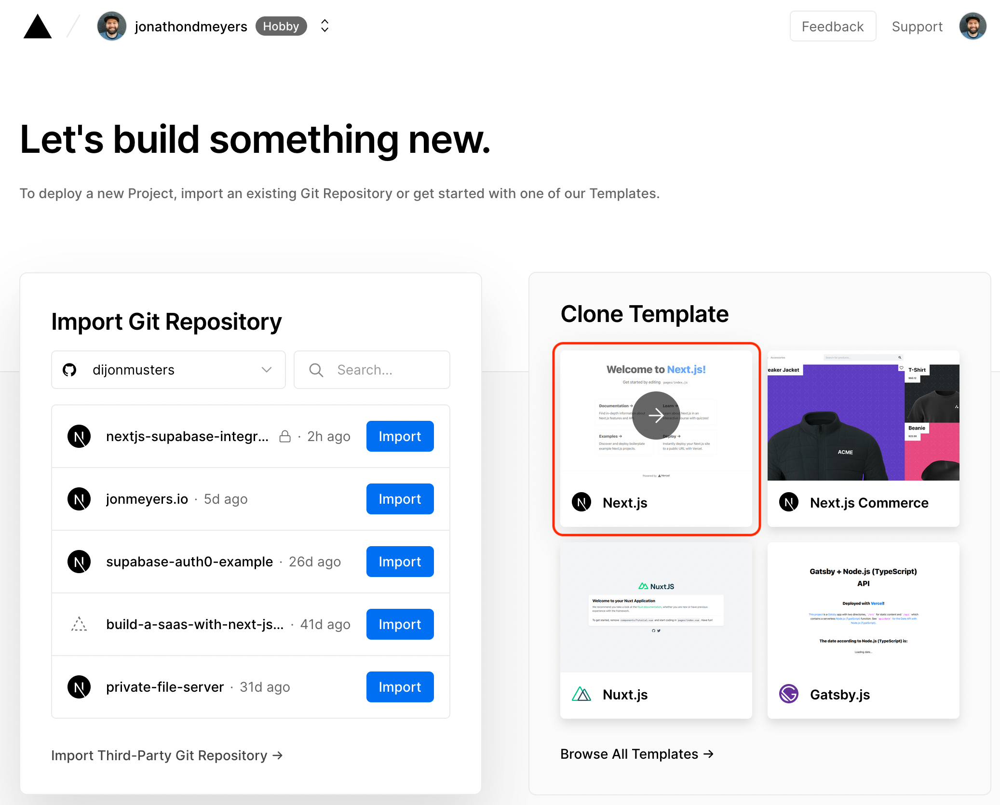
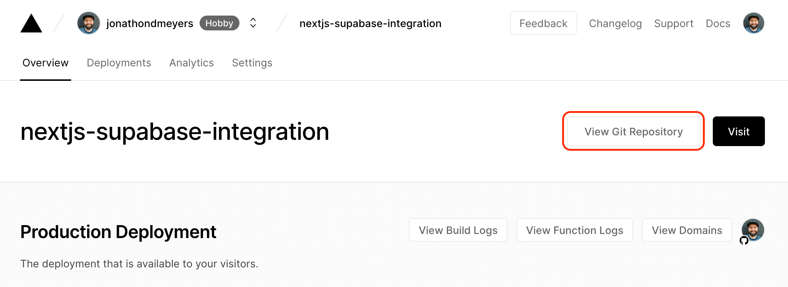
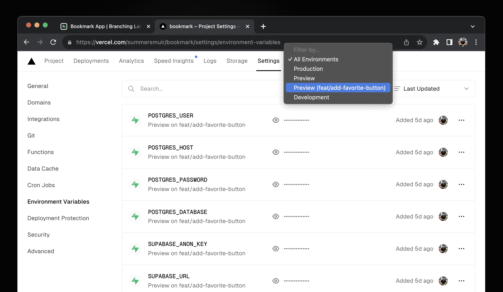

系列：[1 起步](../visual-regression-01-nextjs-bun-biome/) · [2 Vercel](../visual-regression-02-vercel-deploy/) · [3 Supabase](../visual-regression-03-supabase-private-storage/) · [4 Actions](../visual-regression-04-ci-cd/) · [5 Worker](../visual-regression-05-web-worker/) · [6 驗收](../visual-regression-06-correctness-and-access/)

[下載完整範例與圖片（ZIP）](../../downloads/visual-regression-series.zip) · [程式與驗證範圍](../../downloads/visual-regression-series/README.md)

這篇做到：別人用網址開啟圖片比對頁。不需要 Supabase、金鑰或付費網域。

準備：第一篇的 `image-review`、[Git](https://git-scm.com/downloads)、GitHub 帳號、Vercel Hobby 帳號。

圖為官方文件的真實介面；舊版圖已標示。圖中的帳號與專案是官方範例，請填自己的教學專案。

## 1. 確認本機可以建置

在 `image-review` 根目錄執行：

```sh
bun run typecheck
bun run lint
bun run test
bun run build
```

全部成功，再往下。

## 2. 檢查版本設定

開啟 `package.json`。最外層應有：

```json
"packageManager": "bun@1.4.4",
"engines": { "node": "24.x" }
```

這兩項分別指定 Bun 與 Node 版本。

## 3. 準備 Git

在 `image-review` 根目錄執行：

```sh
git --version
git rev-parse --show-toplevel
```

第二個指令應顯示這個教學專案的根目錄。若顯示不是 Git Repository，先執行 `git init`；如果顯示上層的其他專案，先把教學資料夾移到獨立位置。

設定這個教學 Repository 的提交身分。先替換下面兩個值；信箱可從 GitHub → Settings → Emails 取得自己的 no-reply 位址：

```sh
git config user.name "YOUR_NAME"
git config user.email "YOUR_GITHUB_NOREPLY_EMAIL"
```

## 4. 確認不會提交本機設定

開啟 `.gitignore`，確認包含：

```gitignore
.env*
!.env.example
.vercel/
node_modules/
.next/
```

執行：

```sh
git check-ignore .env.local .vercel/project.json
git status --short
```

第一個指令應列出兩個路徑；提交清單不應有金鑰或私人圖片。

## 5. 在 GitHub 建立 Repository

登入 GitHub，右上角「＋」→「New repository」。

逐項填：

1. Repository name：`image-review`。
2. Visibility：`Private`。
3. 不新增 README、`.gitignore` 或 License。
4. 點「Create repository」。

保留這個頁面，下一步要複製 Repository URL。

## 6. 把程式推到 GitHub

回到本機終端機。`YOUR_ACCOUNT` 換成自己的 GitHub 帳號：

```sh
git add .gitignore package.json bun.lock biome.json tsconfig.json next.config.ts src public tests
git commit -m "feat: add local image comparison"
git branch -M main
git remote add origin https://github.com/YOUR_ACCOUNT/image-review.git
git push -u origin main
```

只對這個新教學專案執行。若已經有 `origin`，先確認現有設定，不再新增。

第一次 push 若要求認證，完成 Git Credential Manager 開啟的 GitHub 瀏覽器登入。GitHub HTTPS 不接受帳號密碼作為 Git 密碼；若沒有瀏覽器登入入口，先依 [GitHub HTTPS 認證說明](https://docs.github.com/en/get-started/git-basics/caching-your-github-credentials-in-git)設定 Credential Manager，再重試 push。不要把 Token 寫進 Repository URL。

## 7. 回 GitHub 確認檔案

重新整理 Repository 頁面。

應看到 `src`、`public`、`tests`、`package.json`、`bun.lock`；不應看到 `.env.local`、`node_modules`、`.next`。

## 8. 登入 Vercel

開啟 [Vercel](https://vercel.com/)，用 GitHub 登入。

選個人 Hobby 範圍。這篇不用升級方案。

## 9. 建立 Vercel Project

在帳號首頁點「Add New → Project」。舊版介面的按鈕叫「New Project」。

[](../../downloads/visual-regression-series/images/official/vercel-new-project.webp)

[官方原圖](https://github.com/supabase/supabase/blob/7e866ef83e89e35cdda45a6c98abd069d5fa1b2f/apps/docs/public/img/guides/integrations/vercel/create-vercel-project.png)

圖 2-1｜[官方原圖](../../downloads/visual-regression-series/sources/official-images.json)。找建立 Project 的入口。

## 10. 找到自己的 Repository

在「Import Git Repository」選 GitHub 帳號，搜尋 `image-review`。

如果找不到：

1. 開啟 Repository 存取設定的「Configure GitHub App」或「Adjust GitHub App Permissions」。
2. 選自己的 GitHub 帳號。
3. 選「Only select repositories」。
4. 加入 `image-review`，儲存。
5. 回 Vercel，重新整理列表。

## 11. 點 Repository 旁的 Import

點左側 `image-review` 那一列的「Import」。

[](../../downloads/visual-regression-series/images/official/vercel-import-repository.webp)

[官方原圖](https://github.com/supabase/supabase/blob/7e866ef83e89e35cdda45a6c98abd069d5fa1b2f/apps/docs/public/img/guides/integrations/vercel/clone-next-js-template.png)

圖 2-2｜使用圖左側的 Import。右側紅框是官方原文的 Template 示範，本篇不選它。

## 12. 確認專案名稱與目錄

在部署設定頁確認：

| 欄位 | 填入／選擇 |
| --- | --- |
| Project Name | `image-review`，或可用的名稱 |
| Framework Preset | `Next.js` |
| Root Directory | `./`，這層必須有 package.json |
| Output Directory | 保留 Next.js 預設 |

如果 `image-review` 放在 Repository 的子資料夾，Root Directory 要選那個子資料夾。

## 13. 設定安裝與建置指令

展開 Build／Install 設定；有 Override 開關時先啟用。

| 欄位 | 指令 |
| --- | --- |
| Install Command | `bun install --frozen-lockfile` |
| Build Command | `bun run build` |

Node 使用 `package.json` 指定的 `24.x`。部署設定若另外列出 Node.js Version，也確認為 24.x。

## 14. 環境變數先留空

第一篇只有本機圖片比對。本次部署不新增任何 Supabase 變數。

## 15. 按 Deploy

按「Deploy」，等待安裝與建置完成。

先不要關頁。失敗時展開 Build Logs，找第一個 Error。

## 16. 查看部署結果

成功後，確認這次 Deployment 的狀態為「Ready」。點「Visit」或 Deployment URL。

[](../../downloads/visual-regression-series/images/official/vercel-project-overview.webp)

[官方原圖](https://github.com/supabase/supabase/blob/7e866ef83e89e35cdda45a6c98abd069d5fa1b2f/apps/docs/public/img/guides/integrations/vercel/vercel-project-dashboard.png)

圖 2-3｜找右側 Visit。這張官方範例圖只說明入口，不代表本次教學部署已成功。

## 17. 在公開網站比對一次

在網站首頁依序操作：

1. 點「載入範例」。
2. 確認 Before、After 都出現。
3. 點「開始比對」。
4. 確認差異圖、pixels、百分比都出現。
5. 重新整理，再做一次。

這個教學版的路徑是 `/`，不是完整 Framecheck 的 `/demo`。

## 18. 用未登入的視窗再開一次

開啟無痕視窗，貼上正式網址。

若出現 Vercel 登入要求，先確認開的是 Production 網址，再檢查這個教學 Project 的 Deployment Protection。不要改其他專案的設定。

## 19. 認清三個環境

| 環境 | 在哪裡 | 用途 |
| --- | --- | --- |
| Local | 本機 `bun run dev` | 修改程式 |
| Preview | 非正式分支部署的網址 | 看變更 |
| Production | 正式分支的正式網址 | 給別人使用 |

這篇新專案用 `main`。既有專案若用 `master`，保留原設定，不照抄改分支。

## 20. 找到環境變數設定

開啟 Project → Settings → Environment Variables。

這篇先認位置，第三篇才填 Supabase 變數。新增時必須選對 Production／Preview／Development。

[](../../downloads/visual-regression-series/images/official/vercel-environment-scope.webp)

[官方原圖](https://github.com/supabase/supabase/blob/7e866ef83e89e35cdda45a6c98abd069d5fa1b2f/apps/www/public/images/blog/lwx-supabase-branching/vercel-env-var-settings--light.png)

圖 2-4｜[官方來源：2023-12-13](https://supabase.com/blog/supabase-branching)。只看環境選擇器；不要複製圖中的舊變數名稱。

## 21. 部署失敗時看這裡

Project → Deployments → 選失敗的那筆 → Build Logs。

| 第一個錯誤 | 回哪裡查 |
| --- | --- |
| 找不到 package.json | Root Directory |
| lockfile 不一致 | 本機更新依賴後提交 bun.lock |
| TypeScript error | 本機 `bun run typecheck` |
| Module not found | 檔名大小寫、依賴是否提交 |
| 字型下載失敗 | 建置環境對字型來源的網路存取 |
| Ready，但頁面 500 | Runtime Logs、變數名稱與適用環境 |

不要用關掉型別檢查或提交 `.env.local` 解決建置錯誤。

完成條件：無痕視窗能開首頁，能載入範例並產生比對結果。下一篇再加登入與儲存。

下一篇：[3 Supabase](../visual-regression-03-supabase-private-storage/)。
