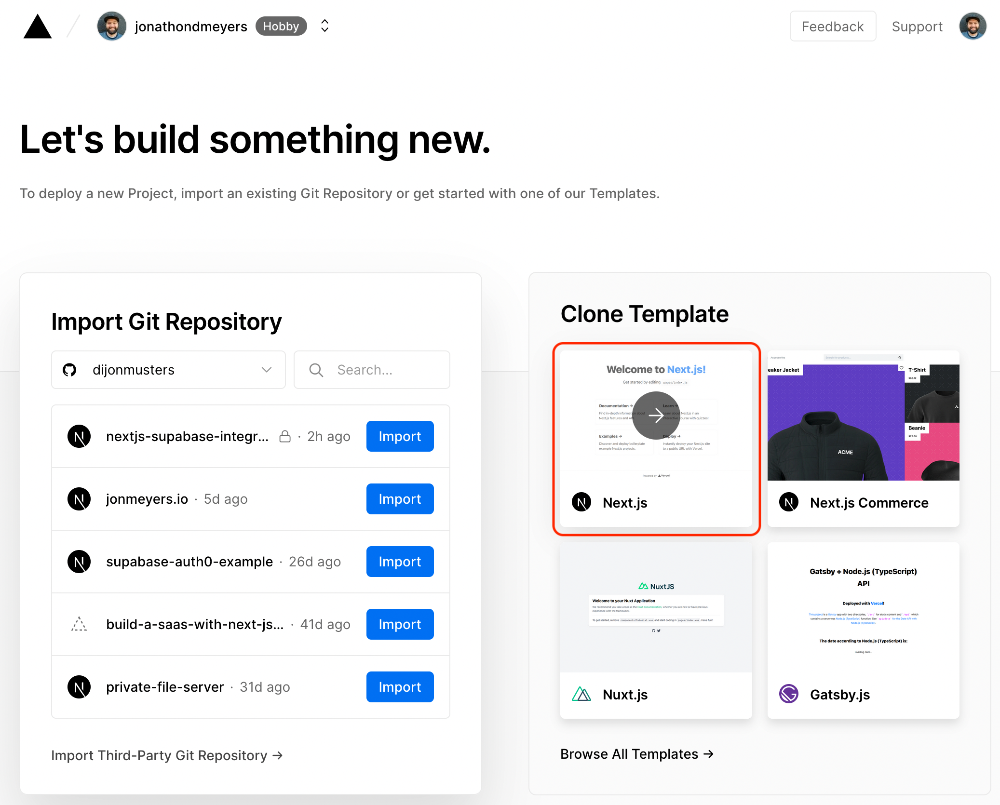
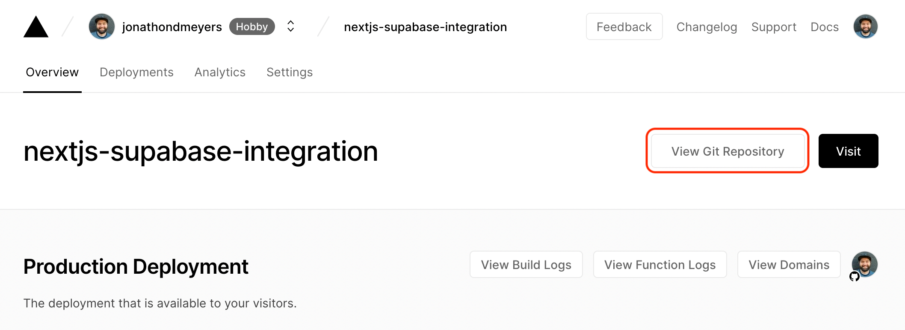
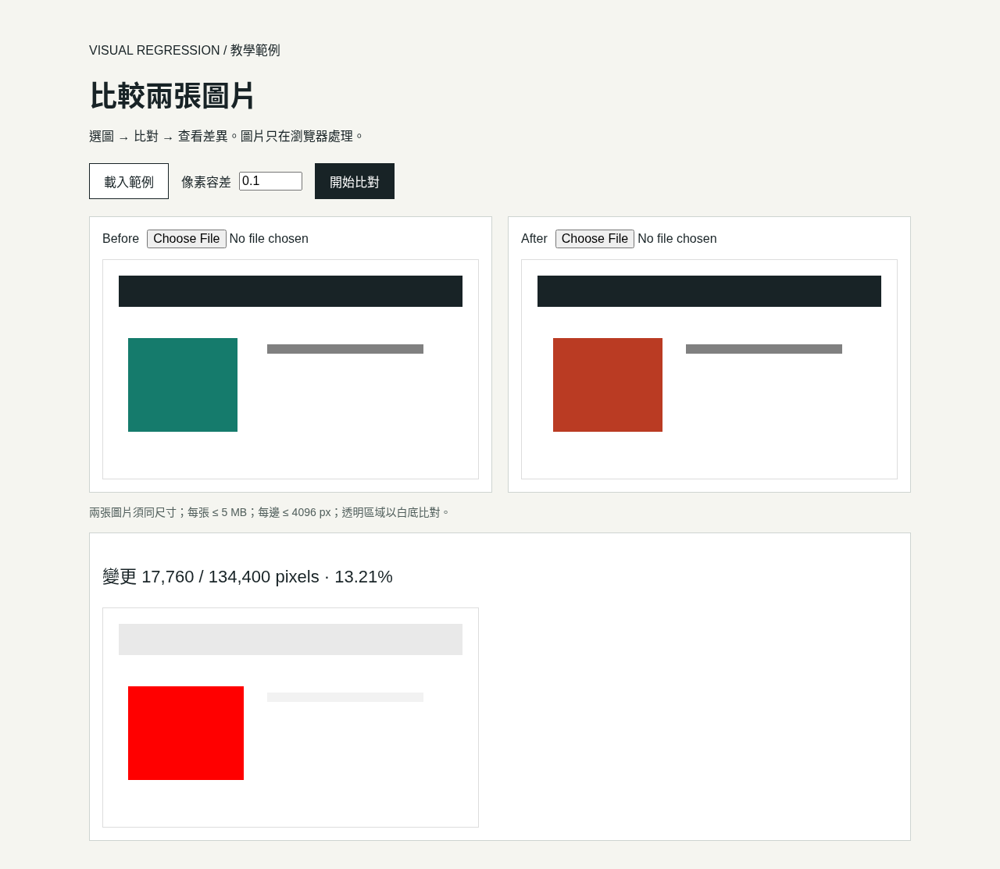

最後會有一個 `.vercel.app` 網址。訪客直接載入兩張樣本就能比較，這版沒有登入功能，先不用建立資料庫。

## 1. 把剛剛通過測試的檔案放進 GitHub

在 GitHub 建空 repository，名稱取 `image-review`，建立時不加 README。回到上一課的 `image-review` 資料夾，確認 `package.json`、`bun.lock` 和附件自帶的 `.gitignore` 都在這一層。若解壓縮時漏了隱藏檔，從附件的 `code/01-local/.gitignore` 補回，否則 Git 會把依賴和本機設定一起加入。

```sh
git init
git add .
git status --short
```

先看這份預備提交的清單。應包含原始碼、設定、樣本及 lockfile。若有 `node_modules/`、`.next/` 或 `.env.local`，先修正 `.gitignore`，用 `git rm -r --cached --ignore-unmatch node_modules .next .env.local` 從暫存區移除它們，再檢查一次。檔案會保留在電腦上。確認後建立 commit：

```sh
git commit -m "Build local image comparison"
git branch -M main
```

在 GitHub 新 repository 首頁複製 HTTPS URL，取代下一行的 `YOUR_GITHUB_URL`。

```sh
git remote add origin YOUR_GITHUB_URL
git push -u origin main
```

## 2. 在 Vercel 指向同一份程式

登入 Vercel，Dashboard 按 **Add New → Project**。選連結 GitHub，授權剛才的 repository，搜尋 `image-review` 後按 **Import**。下圖為官方舊版介面，這一步找左欄的 repository 清單。



[官方介面截圖來源](https://github.com/supabase/supabase/blob/7e866ef83e89e35cdda45a6c98abd069d5fa1b2f/apps/docs/public/img/guides/integrations/vercel/clone-next-js-template.png)

匯入後逐欄核對，再按 **Deploy**：

| 欄位 | 這個專案要填的值 |
| --- | --- |
| Framework Preset | Next.js |
| Root Directory | package.json 所在的那層；照本篇建 repo 可保留根目錄 |
| Node.js Version | 24.x，與 package.json 的 engines 相符 |
| Install Command | bun install --frozen-lockfile |
| Build Command | bun run build |
| Output Directory | 保留 Next.js preset 預設 |
| Environment Variables | 此階段可留空 |

## 3. 用部署紀錄找真正對外的網址

等部署顯示 Ready，點該版本查看來源 commit，與本機 `git rev-parse --short HEAD` 核對。回 Project Overview 按 **Visit**，複製綁定 Production 的網域。若部署失敗，先打開 Build Logs 第一個錯誤：找不到 package.json 就修 Root Directory，lockfile 不一致則回本機檢查依賴、提交更新後的 bun.lock。



[官方介面截圖來源](https://github.com/supabase/supabase/blob/7e866ef83e89e35cdda45a6c98abd069d5fa1b2f/apps/docs/public/img/guides/integrations/vercel/vercel-project-dashboard.png)

## 4. 在無痕視窗核對真的可以用

貼上 Production 網域，按「載入範例」→「開始比對」。應顯示 13.21%；若要求 Vercel 登入，先確認複製的是預定公開的 Production 網域，再檢查此教學專案 Deployment Protection 的受保護環境。若網頁可開但範例 404，在 Network 核對 `/samples/before.png` 和 `/samples/after.png` 都有提交。



保留這個固定網域，下篇設定 [Supabase 回程與私人圖片](../visual-regression-03-supabase-private-storage/)會用到。
