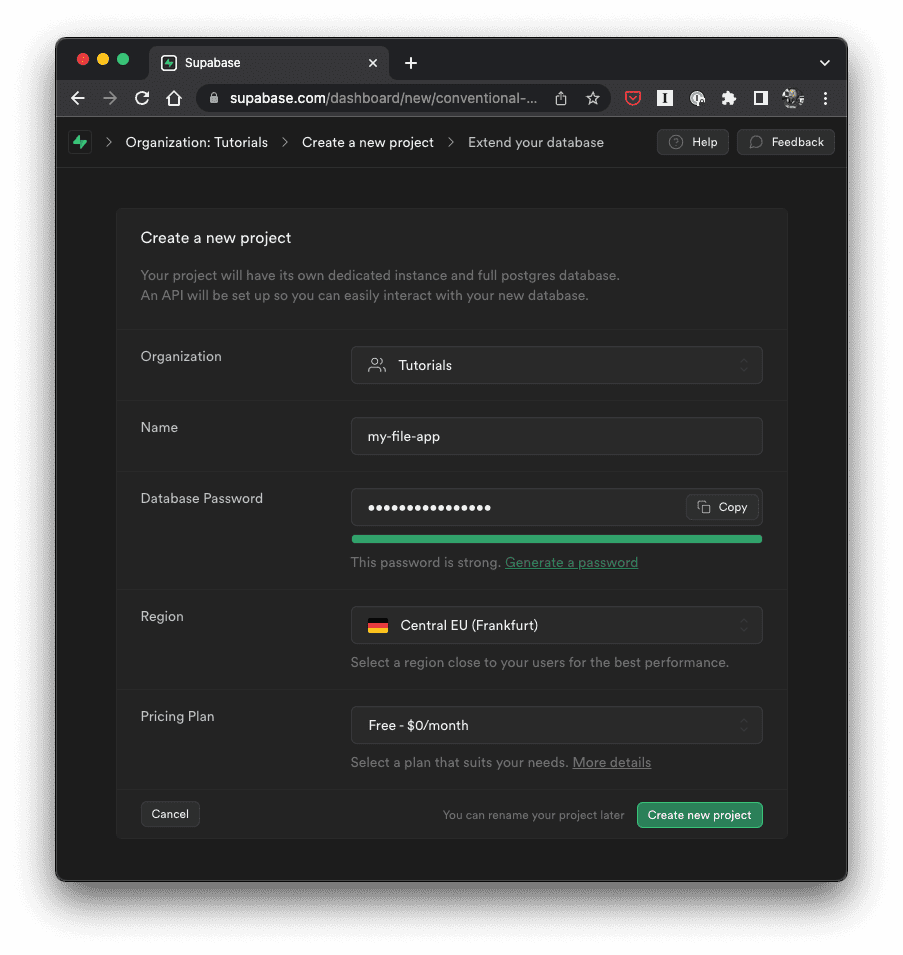
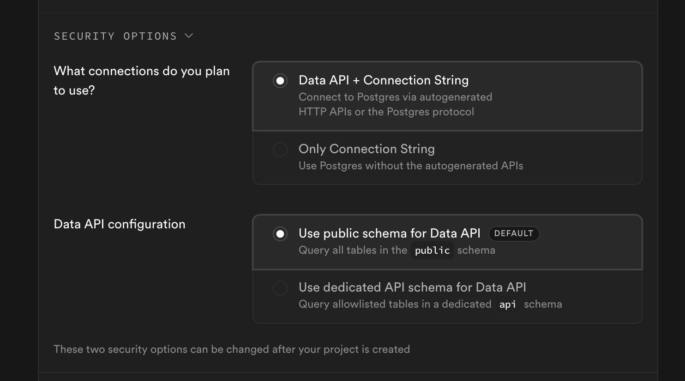
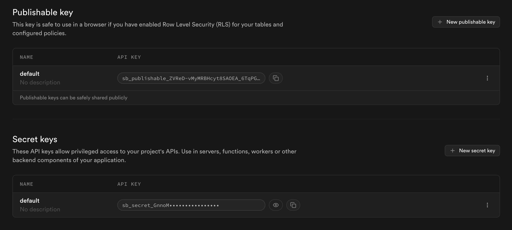
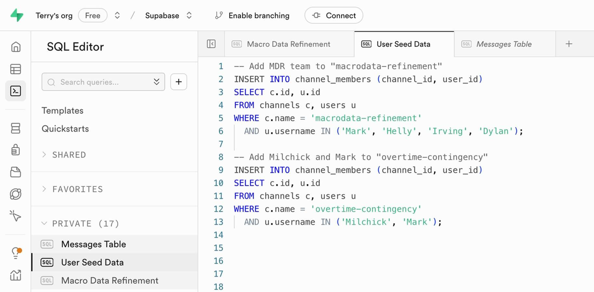
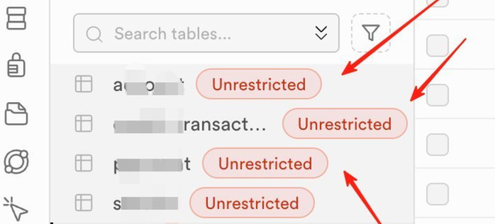
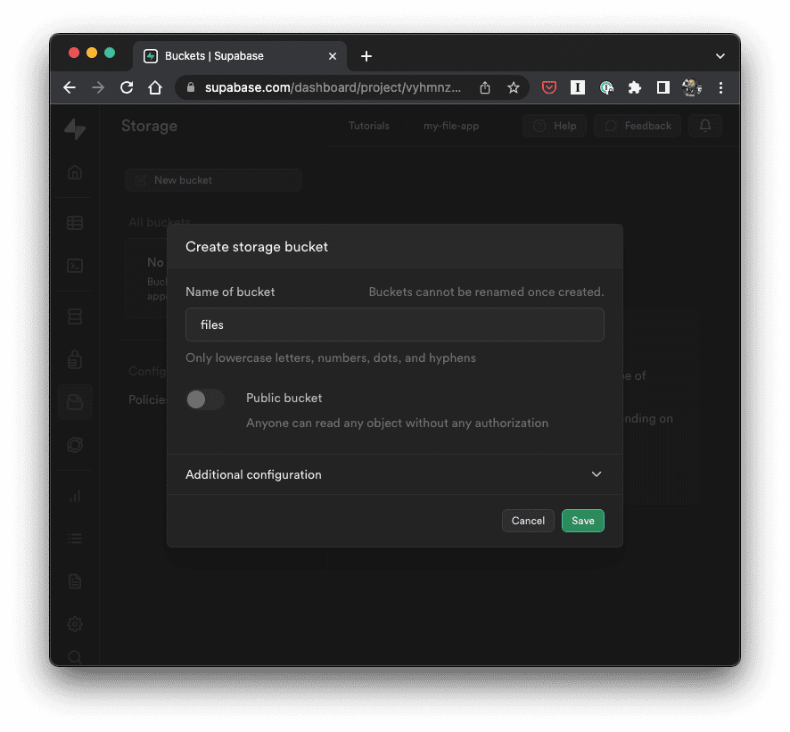
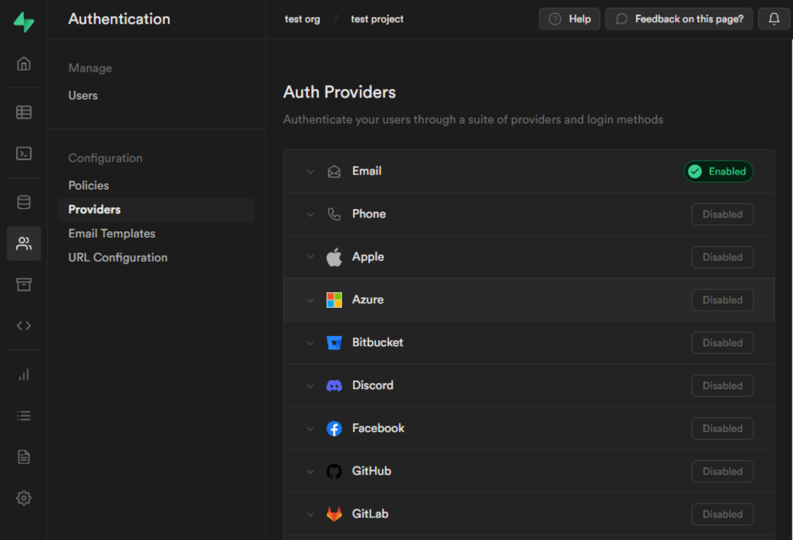
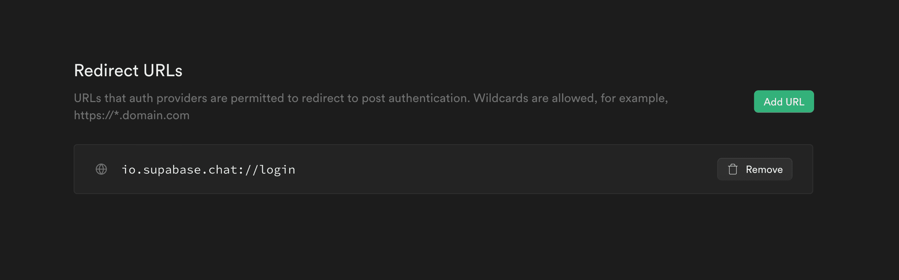

系列：[1 起步](../visual-regression-01-nextjs-bun-biome/) · [2 Vercel](../visual-regression-02-vercel-deploy/) · [3 Supabase](../visual-regression-03-supabase-private-storage/) · [4 Actions](../visual-regression-04-ci-cd/) · [5 Worker](../visual-regression-05-web-worker/) · [6 驗收](../visual-regression-06-correctness-and-access/)

[下載完整範例與圖片（ZIP）](../../downloads/visual-regression-series.zip) · [程式與驗證範圍](../../downloads/visual-regression-series/README.md)

這篇做到：GitHub 登入 → 保存兩張圖片 → 重開歷史紀錄。

準備：第二篇的 `image-review`、Supabase 帳號、附件 `patches/03-supabase/`。

以下使用獨立教學資料庫。教學版只需 Publishable Key，不用 Secret Key 或 `service_role`。

圖為官方文件的實際介面，圖下注明版本與差異；欄位請填本文值，不照抄官方範例帳號或專案。

## 1. 開啟 Supabase Dashboard

登入 [Supabase](https://supabase.com/dashboard)，選要放教學專案的 Organization。

確認使用 Free 方案；已有 Organization 就直接選它。

## 2. 新增 Project

點「New project」，填入：

| 欄位 | 本篇設定 |
| --- | --- |
| Organization | 你的教學 Organization |
| Project name | `image-review` |
| Database password | 在平台產生並自行保管 |
| Region | 選接近使用者的可用區域 |
| Plan | Free |

[](../../downloads/visual-regression-series/images/official/supabase-create-project.webp)

[官方原圖](https://github.com/supabase/supabase/blob/7e866ef83e89e35cdda45a6c98abd069d5fa1b2f/apps/www/public/images/blog/2023-08-01-react-native-storage/new-project.png)

圖 3-1｜[官方來源：2023-08-01](https://supabase.com/blog/react-native-storage)。圖中名稱是官方範例，密碼維持隱藏。

## 3. 確認啟用 Data API

若建立頁有「Security Options」，選：

1. 「Data API + Connection String」。
2. 「Use public schema for Data API」。

這份教學 SQL 的資料表在 `public`，前端透過 Data API 存取。

[](../../downloads/visual-regression-series/images/official/supabase-data-api-option.webp)

[官方原圖](https://github.com/supabase/supabase/blob/7e866ef83e89e35cdda45a6c98abd069d5fa1b2f/apps/www/public/images/blog/2026/security-retro/disable-data-api-create.png)

圖 3-2｜[官方來源：2026-01-07](https://supabase.com/blog/supabase-security-2025-retro)。兩項設定需與本篇資料表位置相符。

## 4. 建立並等待初始化

按「Create new project」。等初始化完成、能開啟 Project Dashboard，再繼續。

## 5. 取得 Project URL

在 Project 的「Connect」或 API 設定頁找到 Project URL，格式為：

```text
https://YOUR_PROJECT.supabase.co
```

複製自己專案顯示的值。不要貼 PostgreSQL Connection String。

## 6. 取得 Publishable Key

開啟 Project Settings → API Keys。

找到「Publishable key」，複製自己的值。不要按 Secret keys 的顯示按鈕。

[](../../downloads/visual-regression-series/images/official/supabase-api-keys.webp)

[官方原圖](https://github.com/supabase/supabase/blob/7e866ef83e89e35cdda45a6c98abd069d5fa1b2f/apps/www/public/images/blog/2026/security-retro/api-keys.png)

圖 3-3｜[官方來源：2026-01-07](https://supabase.com/blog/supabase-security-2025-retro)。本篇只用上半部 Publishable key。

## 7. 建立本機 .env.local

在 `image-review` 根目錄新增 `.env.local`，填入剛才兩個值：

```dotenv
NEXT_PUBLIC_SUPABASE_URL=https://YOUR_PROJECT.supabase.co
NEXT_PUBLIC_SUPABASE_PUBLISHABLE_KEY=YOUR_PUBLISHABLE_KEY
```

這是自己的設定檔，不截圖實際值、不提交 Git。

## 8. 確認設定檔被忽略

```sh
git check-ignore .env.local
git status --short
```

第一個指令應列出 `.env.local`；第二個指令不應列出它。

## 9. 安裝 Supabase 套件

```sh
bun add --exact @supabase/ssr@0.12.7 @supabase/supabase-js@2.118.0
```

之後提交更新的 `package.json` 與 `bun.lock`。

## 10. 放入登入與儲存程式

將附件 `patches/03-supabase/src/` 複製到專案的 `src/`，合併資料夾。

再複製附件 `.env.example` 到根目錄；保留自己填好的 `.env.local`。

應新增：

```text
src/lib/supabase/browser.ts
src/lib/supabase/server.ts
src/proxy.ts
src/app/auth/start/route.ts
src/app/auth/callback/route.ts
src/app/login/page.tsx
src/app/private/page.tsx
src/app/private/viewer.tsx
```

`src/proxy.ts` 更新 Session Cookie；Callback Route 用 code 換 Session。不要只複製登入按鈕。

## 11. 開啟 SQL Editor

回 Supabase，左側點「SQL Editor」，新增 Query。

[](../../downloads/visual-regression-series/images/official/supabase-sql-editor-tabs.webp)

[官方原圖](https://github.com/supabase/supabase/blob/7e866ef83e89e35cdda45a6c98abd069d5fa1b2f/apps/www/public/images/blog/lw14-tabs-dashboard-updates/sql-editor-tabs-light.jpg)

圖 3-4｜[官方來源：2025-04-02](https://supabase.com/blog/tabs-dashboard-updates)。圖中 SQL 是官方範例；下一步改貼附件的完整 SQL。

## 12. 貼上完整 setup.sql

在編輯器開啟附件 [code/03-cloud/sql/setup.sql](../../downloads/visual-regression-series/code/03-cloud/sql/setup.sql)。

全選、複製，貼進剛才的 Query。確認是在新的教學 Project。

完整 SQL 一次建立資料表、RLS、GRANT、私人 Bucket 與 Storage Policies。不要只貼文章中的片段。

## 13. 執行 SQL

點「Run」。確認沒有 Error，再往下。

這份初始 SQL 只執行一次。若已有資料表，不直接重跑；先確認是否選錯 Project，或先前是否已完成。

## 14. 查看資料表與 RLS

左側「Table Editor」→ `public` → `tutorial_comparisons`。

確認資料表存在，RLS 已啟用，且有 `own_read`、`own_insert` Policies。

若出現下圖的「Unrestricted」，代表仍需檢查 RLS，不能視為完成。

[](../../downloads/visual-regression-series/images/official/supabase-unrestricted-warning.webp)

[官方原圖](https://github.com/supabase/supabase/blob/7e866ef83e89e35cdda45a6c98abd069d5fa1b2f/apps/www/public/images/blog/2026/security-retro/unrestricted-tables.png)

圖 3-5｜[官方來源：2026-01-07](https://supabase.com/blog/supabase-security-2025-retro)。這是錯誤狀態示例，表名由官方原圖遮蔽。

## 15. 查看私人 Bucket

左側「Storage」→ `tutorial-images`，確認為 Private。

Bucket 已由 setup.sql 建立；不再按 New bucket 建第二個。

[](../../downloads/visual-regression-series/images/official/supabase-private-bucket.webp)

[官方原圖](https://github.com/supabase/supabase/blob/7e866ef83e89e35cdda45a6c98abd069d5fa1b2f/apps/www/public/images/blog/2023-08-01-react-native-storage/new-bucket.png)

圖 3-6｜[官方來源：2023-08-01](https://supabase.com/blog/react-native-storage)。只對照 Public bucket 關閉的狀態；圖中 `files` 不是本篇 Bucket 名稱。

## 16. 開啟 GitHub Provider

Supabase 左側「Authentication」→「Sign In / Providers」→「GitHub」。

若介面將 Providers 放在 Sign In 頁面內，先進 Sign In 再選 GitHub。

[](../../downloads/visual-regression-series/images/official/supabase-oauth-provider-list.webp)

[官方原圖](https://github.com/supabase/supabase/blob/7e866ef83e89e35cdda45a6c98abd069d5fa1b2f/apps/docs/public/img/supabase-oauth-logins.png)

圖 3-7｜官方舊版介面。點 GitHub 那一列；左側 URL Configuration 會在步驟 22 使用。

## 17. 複製 Supabase Callback URL

在 GitHub Provider 設定面板找到 Callback URL，複製完整網址。

格式為：

```text
https://YOUR_PROJECT.supabase.co/auth/v1/callback
```

先保留這個 Supabase 頁面；下一步另開 GitHub 分頁。

## 18. 在 GitHub 建立 OAuth App

GitHub 右上角頭像 →「Settings」。

左側最下方「Developer settings」→「OAuth Apps」→「New OAuth App」。第一次建立時，按鈕可能顯示「Register a new application」。

選 OAuth App，不選 GitHub App。

## 19. 填入 OAuth App 欄位

| 欄位 | 填入 |
| --- | --- |
| Application name | `image-review-local` |
| Homepage URL | `http://localhost:3000` |
| Application description | 可留空 |
| Authorization callback URL | 步驟 17 複製的 Supabase Callback URL |

確認 Callback 有 `/auth/v1/callback`，再點「Register application」。

## 20. 取得 GitHub Client ID 與 Secret

複製 OAuth App 的 Client ID。

點「Generate a new client secret」，完成 GitHub 要求的驗證。Secret 只填回 Supabase，不貼到 Next.js、文章或聊天。

## 21. 回 Supabase 啟用 GitHub

回到步驟 16 的 GitHub Provider：

1. 開啟 Enable GitHub。
2. Client ID 填 GitHub 的 Client ID。
3. Client Secret 填剛產生的 Secret。
4. 點「Save」。

## 22. 設定網站 Site URL

Supabase → Authentication → URL Configuration。

Site URL 填：

```text
http://localhost:3000
```

儲存 Site URL。

## 23. 加入網站 Callback

在同頁的 Redirect URLs 點「Add URL」，填：

```text
http://localhost:3000/auth/callback
```

儲存，確認它出現在列表。

[](../../downloads/visual-regression-series/images/official/supabase-redirect-urls.webp)

[官方原圖](https://github.com/supabase/supabase/blob/7e866ef83e89e35cdda45a6c98abd069d5fa1b2f/apps/www/public/images/blog/flutter-chat-auth/url-configuration.png)

圖 3-8｜官方舊版介面。只對照 Add URL 位置；圖中的 Flutter deep link 不適用本篇，請填上面的 HTTP 網址。

## 24. 核對兩段 Callback

| 填在哪裡 | 結尾應該是 |
| --- | --- |
| GitHub OAuth App | Supabase 的 `/auth/v1/callback` |
| Supabase Redirect URLs | 網站的 `/auth/callback` |

流程：GitHub 回 Supabase，Supabase 再回網站。兩個網址不要對調。

## 25. 重啟本機網站

終端機按 `Ctrl+C`，再執行：

```sh
bun run dev
```

開啟 `http://localhost:3000/login`。

環境變數變更後要重啟；若仍使用舊頁面，重新整理。

## 26. 完成第一次登入

點 GitHub 登入 → 檢查授權 App 名稱 → 同意授權。

應回到網站的 `/private`。若回到錯誤頁，先核對步驟 17、19、22、23。

## 27. 儲存一筆比對

在 `/private` 依序操作：

1. 載入範例。
2. 開始比對。
3. 儲存比較。
4. 確認沒有錯誤訊息。
5. 點「重新讀取歷史」。

歷史應新增一筆紀錄。記錄的數值由 Browser 提交；Server 重算尚未加入這份教學版。

## 28. 重開圖片

重新整理 `/private`，再讀取歷史。

點紀錄的時間，再開 Before／After 連結。兩張原圖應能打開。

Signed URL 有效 60 秒；過期後重新點歷史取得新連結，不把 Signed URL 存進資料表。

## 29. 檢查 Storage 的檔案

回 Supabase → Storage → `tutorial-images`。

應看到以登入使用者 ID 開頭的路徑。Bucket 仍是 Private；圖片能開啟是因為使用了短效 Signed URL。

## 30. 用第二個帳號驗收

使用另一個 Browser Profile 登入教學帳號 B。

1. B 的歷史不能看到 A 的紀錄。
2. B 不能取得 A 圖片的新 Signed URL。
3. 登出後開 `/private`，應回登入頁。

SQL Editor 可能有管理員權限；不能只靠它判斷 RLS 是否有效。第六篇再做直接請求的檢查。

## 31. 把程式更新推到 GitHub

提交 `src/`、`.env.example`、`package.json`、`bun.lock` 與本篇新增的其他程式檔。

提交前再確認 `.env.local` 沒有進入清單，然後 push。

## 32. 在 Vercel 加入兩項變數

Vercel → 這個 Project → Settings → Environment Variables。

新增第一項：

1. Name：`NEXT_PUBLIC_SUPABASE_URL`。
2. Value：自己的 Project URL。
3. Environment：Production。
4. Save。

用同樣操作新增 `NEXT_PUBLIC_SUPABASE_PUBLISHABLE_KEY`。

[](../../downloads/visual-regression-series/images/official/vercel-environment-scope.webp)

[官方原圖](https://github.com/supabase/supabase/blob/7e866ef83e89e35cdda45a6c98abd069d5fa1b2f/apps/www/public/images/blog/lwx-supabase-branching/vercel-env-var-settings--light.png)

圖 3-9｜[官方來源：2023-12-13](https://supabase.com/blog/supabase-branching)。本篇名稱以上文為準；不填圖中的 POSTGRES 變數。

## 33. 加入正式網址的 Callback

複製第二篇取得的 Production 網址。假設是 `https://YOUR_APP.vercel.app`：

1. Supabase Site URL 改為 `https://YOUR_APP.vercel.app`，儲存。
2. Redirect URLs 保留本機網址。
3. 再新增 `https://YOUR_APP.vercel.app/auth/callback`，儲存。
4. GitHub OAuth App 的 Homepage URL 改為正式網址。
5. GitHub 的 Authorization callback URL 仍是 Supabase 網址，不變。

這裡先只開 Production。Preview 要另連教學資料庫，並另加精確 Callback。

## 34. 重新部署

Vercel → Deployments → 選最新對應版本 →「⋯」→「Redeploy」。

確認目標環境是 Production，再執行。新增變數不會回填到既有 Deployment，必須重新部署。

## 35. 在正式站重做一次

用新的瀏覽器視窗開正式站 `/login`：

登入 → 載入範例 → 比對 → 儲存 → 重新整理 → 讀取歷史 → 重開原圖。

全部成功，才算這篇的雲端流程完成。

## 出錯時先查這四處

| 現象 | 先查 |
| --- | --- |
| GitHub 回報 Callback 不符 | GitHub 是否填 Supabase Callback |
| 登入後回錯網站 | Site URL、Redirect URLs、目前瀏覽器網址 |
| 儲存遭拒絕 | RLS、GRANT、Storage Policies、登入狀態 |
| 本機成功，正式站失敗 | Vercel 變數的環境、是否已 Redeploy |

不要停用 RLS，也不要把 Bucket 改 Public 來繞過錯誤。

圖與步驟可供對照；本文未把官方示意畫面算成本教學 Project 的雲端驗收紀錄。

下一篇：[4 Actions](../visual-regression-04-ci-cd/)。
