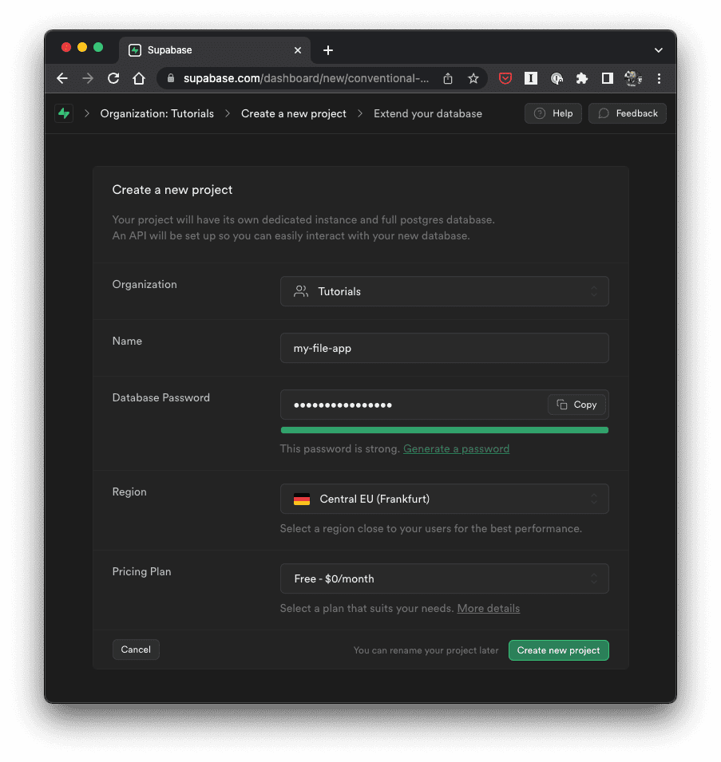
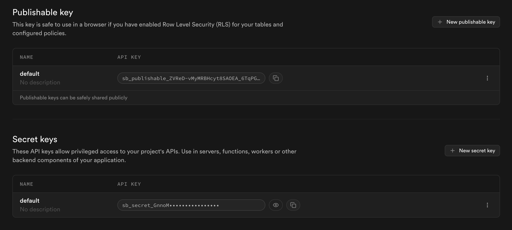
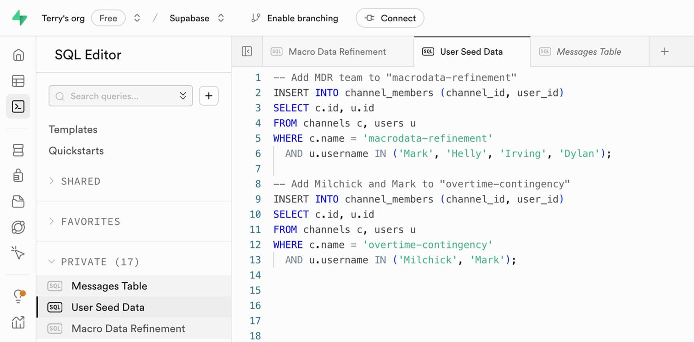
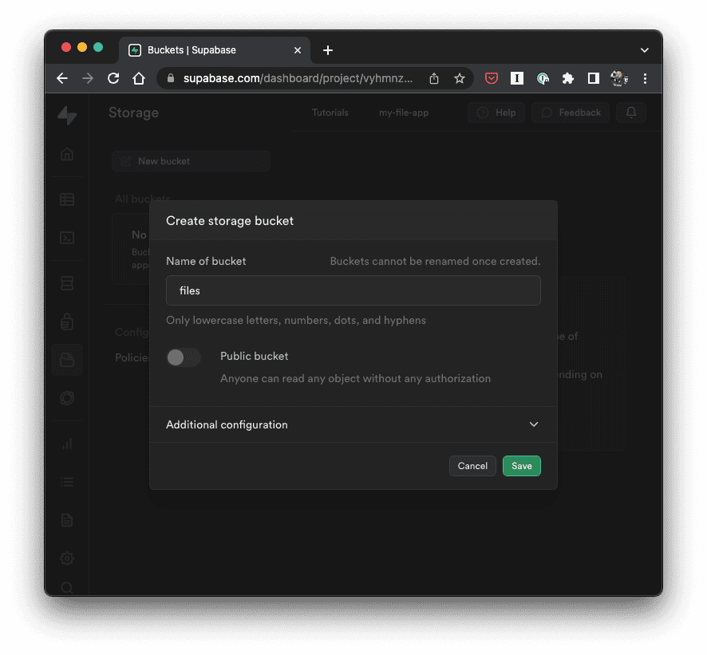
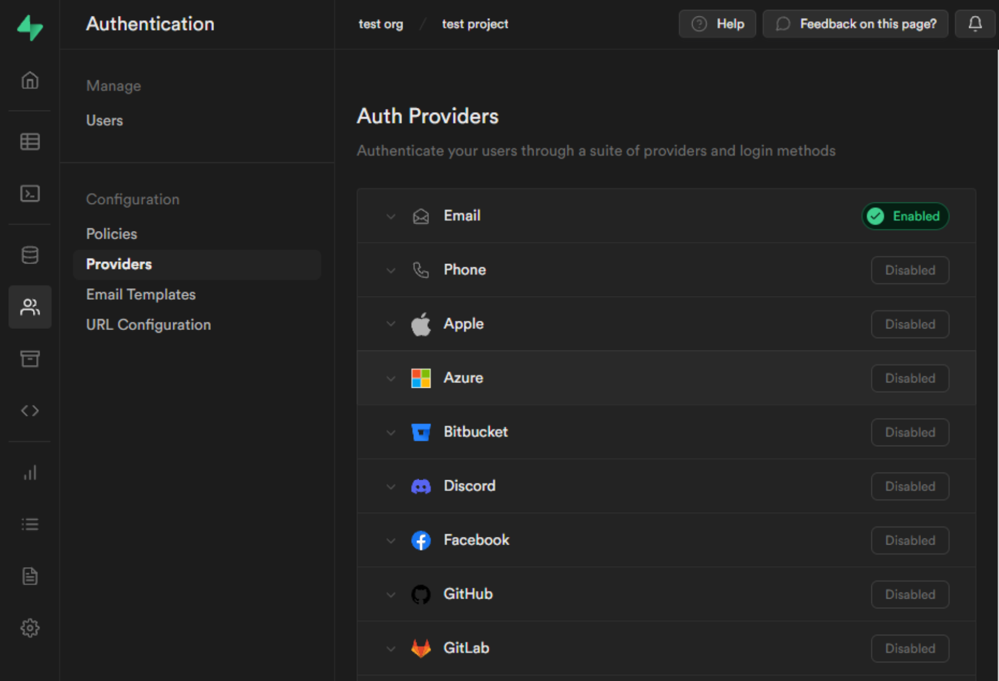
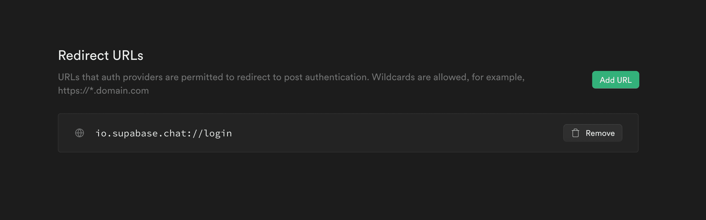
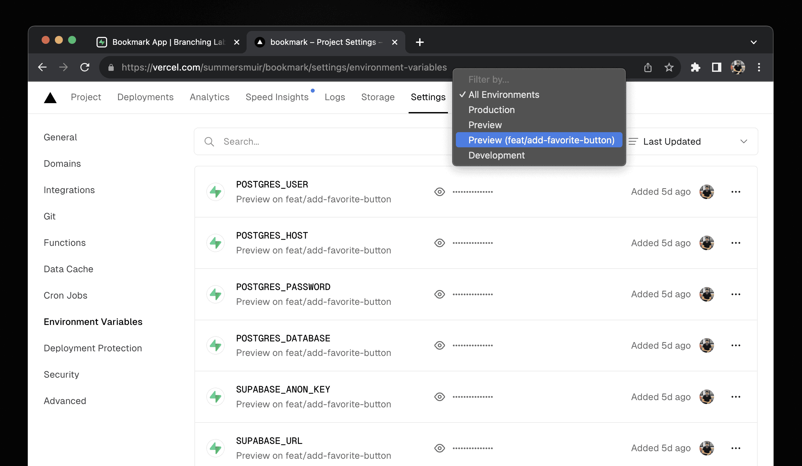

本篇的驗收動作是關掉分頁、重新登入，仍能打開上次存的兩張圖。先完成[公開的本機比對器](../visual-regression-02-vercel-deploy/)，準備自己的 GitHub、Supabase 和 Vercel 教學專案，以及 [下載本系列實作附件](../../downloads/visual-regression-series.zip)。

## 1. 建立資料庫，把公開連線資訊接進本機

Supabase Dashboard 選 Organization → **New Project**，命名 `image-review`、選區域並保存資料庫密碼。等待初始化。若畫面有 Data API 選項，啟用 Data API 並提供 `public` schema。接著從 Connect 取得 Project URL，從 Settings → API Keys 取得 **Publishable key**。



[官方介面截圖來源](https://github.com/supabase/supabase/blob/7e866ef83e89e35cdda45a6c98abd069d5fa1b2f/apps/www/public/images/blog/2023-08-01-react-native-storage/new-project.png)



[官方介面截圖來源](https://github.com/supabase/supabase/blob/7e866ef83e89e35cdda45a6c98abd069d5fa1b2f/apps/www/public/images/blog/2026/security-retro/api-keys.png)

回 Next.js 根目錄建立 `.env.local`，把下列兩個值換成剛取得的資料。執行 `git check-ignore .env.local` 應印出檔名。

```dotenv
NEXT_PUBLIC_SUPABASE_URL=https://YOUR_PROJECT.supabase.co
NEXT_PUBLIC_SUPABASE_PUBLISHABLE_KEY=YOUR_PUBLISHABLE_KEY
```

## 2. 建立資料表與檔案空間

在新的教學資料庫點 **SQL Editor → New query**，貼[完整 setup.sql](../../downloads/visual-regression-series/code/03-cloud/sql/setup.sql)，按 Run 一次。到 Table Editor 開 `tutorial_comparisons`，確認已啟用 RLS，並有 `own_read` 和 `own_insert`。到 Storage 開 `tutorial-images`，確認 Private。SQL 已經建好這個 Bucket。



[官方介面截圖來源](https://github.com/supabase/supabase/blob/7e866ef83e89e35cdda45a6c98abd069d5fa1b2f/apps/www/public/images/blog/lw14-tabs-dashboard-updates/sql-editor-tabs-light.jpg)



[官方介面截圖來源](https://github.com/supabase/supabase/blob/7e866ef83e89e35cdda45a6c98abd069d5fa1b2f/apps/www/public/images/blog/2023-08-01-react-native-storage/new-bucket.png)

每次儲存有三筆東西。兩張 PNG 寫在 `使用者 ID/這次的 UUID/before.png` 和 `after.png`；資料表另寫一列，欄位包括 owner_id、兩個路徑、尺寸、threshold 和 changed_pixels。Storage 的 policy 比對路徑第一段與 `auth.uid()`，資料表的 policy 比對 owner_id。兩層都要設。

## 3. 接好兩個不同的 Callback

Supabase → Authentication → Sign In / Providers → GitHub，先複製面板上的 callback。另開 GitHub → Settings → Developer settings → OAuth Apps → **New OAuth App**。Application name 填 `image-review`，Homepage URL 和 Authorization callback URL 照下表填。按 **Register application** 後，複製 Client ID，按 **Generate a new client secret** 取得 Client Secret。把這兩個值填回 Supabase 的 GitHub provider，啟用後儲存。



[官方介面截圖來源](https://github.com/supabase/supabase/blob/7e866ef83e89e35cdda45a6c98abd069d5fa1b2f/apps/docs/public/img/supabase-oauth-logins.png)

| 設定位置 | 填什麼 | 誰呼叫誰 |
| --- | --- | --- |
| GitHub OAuth App 的 Homepage URL | http://localhost:3000 | 開發中的應用首頁 |
| GitHub OAuth App 的 Authorization callback URL | Supabase 提供的 https://YOUR_PROJECT.supabase.co/auth/v1/callback | GitHub 將授權交回 Supabase |
| Supabase 的 Authentication → URL Configuration → Site URL | 先用 `http://localhost:3000`，上線後改正式網域 | 應用預設目的地 |
| 同頁 Redirect URLs | http://localhost:3000/auth/callback 和自己的正式網域加 /auth/callback | Supabase 回到你的 Next.js |



[官方介面截圖來源](https://github.com/supabase/supabase/blob/7e866ef83e89e35cdda45a6c98abd069d5fa1b2f/apps/www/public/images/blog/flutter-chat-auth/url-configuration.png)

## 4. 把登入流程接到 Next.js

回到前篇的專案執行下列指令。從附件 `patches/03-supabase/src/` 把內容合併到專案的 `src/`，維持子目錄結構。完整結果可對照 `code/03-cloud`。

```sh
bun add --exact @supabase/ssr@0.12.7 @supabase/supabase-js@2.118.0
bun run dev
```

開啟 `http://localhost:3000/login`，點 GitHub 登入。瀏覽器先進 `src/app/auth/start/route.ts`，它向 Supabase 指定 GitHub provider 及自己的 `/auth/callback`。返回時 `src/app/auth/callback/route.ts` 讀取 code，以 `exchangeCodeForSession(code)` 建立 session，成功後導向 `/private`。若回到 login，先比對步驟 3 兩段 callback 的 host、路徑與連接埠。

## 5. 讀回第一筆紀錄，再把設定帶上 Vercel

在 `/private` 載入樣本、比對、儲存，點「重新讀取歷史」。選剛才的時間，會出現 Before、After 連結，程式核發的簽章期限為 60 秒。記下這筆紀錄的時間，按「登出」，用同一個 GitHub 帳號再登入，再次讀取歷史並開兩張圖。若有紀錄卻打不開圖，先比對 Storage 物件路徑與該列 before_path，再查 `own_image_read` policy。

停止 dev，執行 `bun run check`，提交應用程式和 lockfile 到教學 repo。到 Vercel Project → Settings → Environment Variables，加上步驟 1 的兩個同名變數，選 **Production**。把程式推到主分支，必要時 Redeploy 讓設定進入新 build。在正式網域登入、存一筆、重新讀取。只有完成這三個動作才能確認 OAuth、資料表和 Storage 都通。



[官方介面截圖來源](https://github.com/supabase/supabase/blob/7e866ef83e89e35cdda45a6c98abd069d5fa1b2f/apps/www/public/images/blog/lwx-supabase-branching/vercel-env-var-settings--light.png)

接著[將測試串進 GitHub Actions](../visual-regression-04-ci-cd/)。
