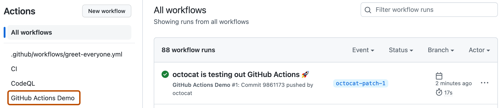
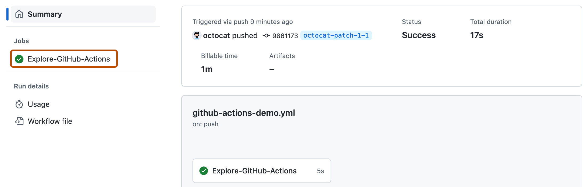
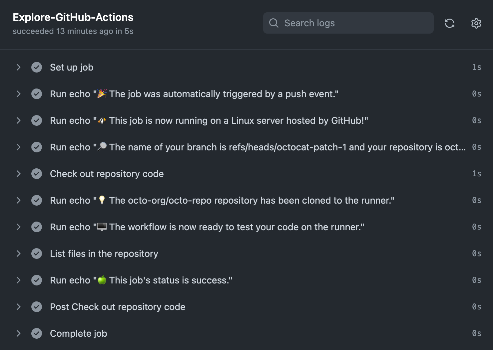
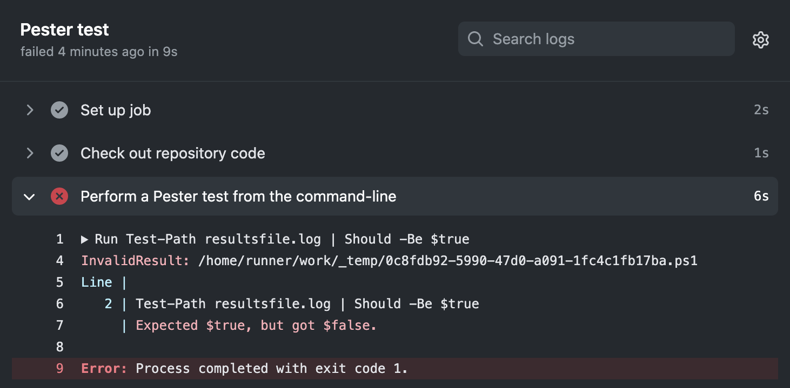

系列：[1 起步](../visual-regression-01-nextjs-bun-biome/) · [2 Vercel](../visual-regression-02-vercel-deploy/) · [3 Supabase](../visual-regression-03-supabase-private-storage/) · [4 Actions](../visual-regression-04-ci-cd/) · [5 Worker](../visual-regression-05-web-worker/) · [6 驗收](../visual-regression-06-correctness-and-access/)

[下載完整範例與圖片（ZIP）](../../downloads/visual-regression-series.zip) · [程式與驗證範圍](../../downloads/visual-regression-series/README.md)

完成流程：push → GitHub Actions 檢查 → 人工核對 commit → 手動部署。

先完成第三篇，準備附件 `code/04-ci/`。本篇沒有自動 CD，也沒有機器強制的部署 Gate；不需要部署 Token。


## 1. 先在本機檢查

在 `image-review` 根目錄執行：

```sh
bun run check
```

型別、Biome、測試、build 都成功，才繼續。build 通過仍不代表 OAuth、RLS、Storage 已驗收。


## 2. 確認正式分支

開 GitHub 教學 Repository，確認預設分支名稱。

以下使用 `main`。若你的教學 Repo 用 `master`，後續指令與 Workflow 都改成 `master`。


## 3. 放入 Workflow

在專案建立 `.github/workflows/`，將附件 `code/04-ci/.github/workflows/check.yml` 放入。

開啟檔案，確認 `push.branches` 與步驟 2 相同，`pull_request` 保留。


## 4. 檢查 Workflow 指令

確認 Workflow 依序使用 Node.js 24、Bun 1.4.4，並執行：

```yaml
- run: bun install --frozen-lockfile
- run: bun run typecheck
- run: bun run lint
- run: bun run test
- run: bun run build
```

這組 CI 不放 Supabase 金鑰；附件的比對測試不會驗證雲端 OAuth 或 Storage。


## 5. 停用這個教學 Repo 的 Git 自動部署

在專案根目錄加入附件 `code/04-ci/vercel.json`：

```json
{
  "git": {
    "deploymentEnabled": false
  }
}
```

若已有 `vercel.json`，只合併 `git.deploymentEnabled`，保留其他設定。

單獨加入 Actions 不會讓 Vercel 等待它。此設定須在推送後實際驗證，不能只看檔案就判定生效。


## 6. 提交設定

```sh
git status --short
git add .github/workflows/check.yml vercel.json
git commit -m "ci: add checks and use manual deployment"
git push
```

先確認狀態清單沒有 `.env.local`、Token 或私人圖片。指令若失敗，先處理輸出，不重複提交。


## 7. 打開 Actions

GitHub 教學 Repository → Actions → 找到這次 commit 的 `Tutorial Check`。

點進執行紀錄，再開 `check` job。名稱以附件 Workflow 為準。


[](../../downloads/visual-regression-series/images/official/github-actions-runs.webp)

[官方原圖](https://github.com/github/docs/blob/02c25d16369fe27f9bdb28d1201f6b452f0d21dd/assets/images/help/repository/actions-quickstart-workflow-sidebar.png)

圖 4-1｜官方 Quickstart 的執行列表；Workflow 名稱與 commit 以你的教學 Repository 為準。

[](../../downloads/visual-regression-series/images/official/github-actions-job.webp)

[官方原圖](https://github.com/github/docs/blob/02c25d16369fe27f9bdb28d1201f6b452f0d21dd/assets/images/help/repository/actions-quickstart-job.png)

圖 4-2｜找這次執行的 Job。這不是本附件的雲端通過紀錄。

## 8. 展開每個檢查

依序展開 install、typecheck、lint、test、build。

確認每個步驟成功，test 有實際執行測試。不要把零測試或 skipped 當成測試通過。


[](../../downloads/visual-regression-series/images/official/github-actions-steps.webp)

[官方原圖](https://github.com/github/docs/blob/02c25d16369fe27f9bdb28d1201f6b452f0d21dd/assets/images/help/repository/actions-quickstart-logs.png)

圖 4-3｜點步驟旁的箭頭看 log；本篇應看到 Bun 的安裝、型別、Biome、測試與 build。

## 9. 確認 push 沒有觸發 Vercel 部署

Vercel → 第二篇建立的教學 Project → Deployments。

檢查剛才的 commit。若仍因 push 產生 Git 部署，先核對 `vercel.json`、commit 與官方設定行為，暫停後續發布。


## 10. 建立測試分支

```sh
git switch -c test/ci-failure
```

開啟 `tests/diff.test.ts`，找到相同圖片的測試。暫時把預期 changed pixels 從 `0` 改成 `1`。


## 11. 推送並開 PR

```sh
git add tests/diff.test.ts
git commit -m "test: demonstrate CI failure"
git push -u origin test/ci-failure
```

回 GitHub，點 Compare & pull request。確認 base 是正式分支，再點 Create pull request。


## 12. 打開失敗的測試

在 PR 點失敗的 check，再進入 test 步驟。

應看到相同圖片測試的預期值與實際值不同。再到 Vercel 確認沒有這次 push 的 Git 部署。


[](../../downloads/visual-regression-series/images/official/github-actions-failed-assertion.webp)

[官方原圖](https://github.com/github/docs/blob/02c25d16369fe27f9bdb28d1201f6b452f0d21dd/assets/images/help/repository/actions-failed-pester-test-updated.png)

圖 4-4｜官方 PowerShell／Pester 失敗畫面，說明找預期值、實際值與 exit code 的位置；不是本篇 Bun 測試結果。

## 13. 修回預期值

把 `1` 改回 `0`，提交並 push。

```sh
git add tests/diff.test.ts
git commit -m "test: restore identical-image expectation"
git push
```

回 PR，等最新 commit 的所有檢查通過。


## 14. 合併 PR，再等正式分支檢查

確認 Files changed 只剩預期設定後合併。

到 Actions 開啟正式分支的新執行紀錄。確認通過的 commit，記下 SHA。

GitHub Free 私人 Repo 的 branch protection 能力以目前方案為準。沒有強制規則時，由人遵守這個流程。


## 15. 同步同一個 commit

```sh
git switch main
git pull --ff-only
git status --short
git rev-parse HEAD
```

`git status --short` 應沒有輸出；HEAD 應等於步驟 14 通過的 SHA。不同就先查明，不發布。


## 16. 登入並連結 Vercel

```sh
bunx vercel login
bunx vercel link
```

在互動選項中選第二篇的教學帳戶／scope 與 Project。不要新建或連到既有正式專案。


## 17. 部署 Preview

```sh
bunx vercel deploy
```

開啟輸出的 Preview URL，檢查首頁與本機圖片比對。要測 Preview OAuth，須先設定精確 Callback 與獨立教學 Supabase 環境。


## 18. 部署 Production

Preview 驗收後，確認工作目錄與 HEAD 未變，再執行：

```sh
bunx vercel deploy --prod
```

正式站重新驗證登入、儲存、歷史與重開圖片。Production 與 Preview 的環境變數可能不同。


## 19. 失敗時看哪裡

建置失敗：Deployments → 本次版本 → Build Logs，找第一個 Error。

網站 500：看本次版本的 Runtime Logs。截圖只留錯誤，不包含金鑰或私人請求內容。


需要回退時，在 Dashboard 選已驗收的舊部署，依可用的 Rollback 操作回退。回退網站不會回退資料庫。

Actions、停用自動部署與手動發布需在你的教學 Project 依上述步驟驗收；文中的官方圖是操作位置對照。

下一篇：[5 Worker](../visual-regression-05-web-worker/)。
