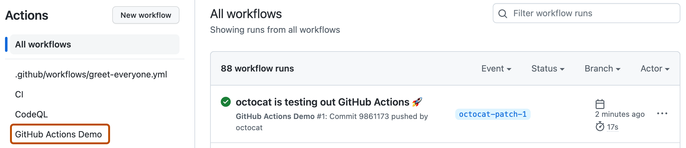
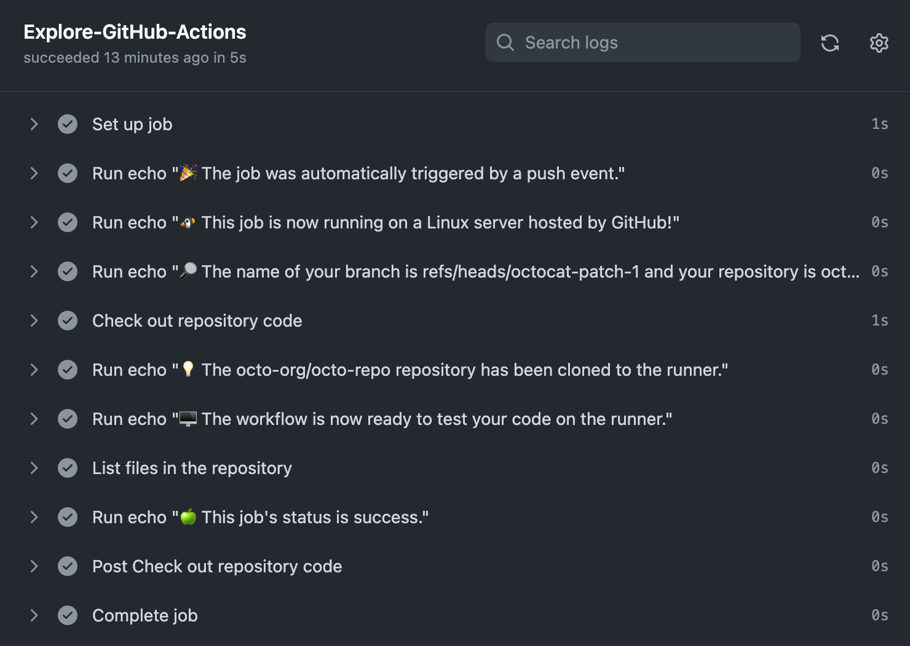
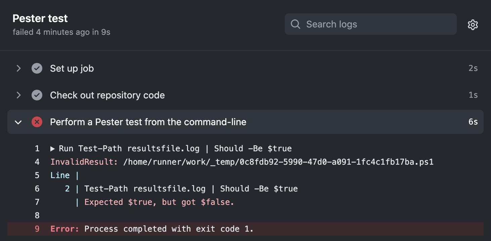

部署前最有用的綠燈，是你看過它在哪種錯誤下會變紅。本篇在自己的教學 repo 設定 CI，再故意把「同一張圖應該有零個不同像素」改錯一次。

## 1. 把本機指令接到雲端 Runner

在 `image-review` 根目錄先跑 `bun run check`。[下載本系列實作附件](../../downloads/visual-regression-series.zip)，把 `code/04-ci/.github/workflows/check.yml` 和 `code/04-ci/vercel.json` 依原路徑放進 repo 根目錄。編輯器要能顯示隱藏的 `.github` 目錄。開啟 YAML，核對 push 到 main 以及 pull_request 都會執行 check job。

| 依序執行 | 為何在這裡失敗會有意義 |
| --- | --- |
| bun install --frozen-lockfile | Runner 依提交的版本還原套件 |
| bun run typecheck、bun run lint | 介面型別、格式與靜態規則的錯誤可先定位 |
| bun run test | 用已知像素陣列檢查輸出 |
| bun run build | 驗證 Next.js 能打包成 production 版本 |

`vercel.json` 的 `git.deploymentEnabled` 設為 false，這個練習會改由人執行部署。提交上述兩份檔並推到 main。GitHub → **Actions → Tutorial Check** → 最新的 run → **check**，展開 test，找實際執行的五個測試；在 Vercel Deployments 核對這個 push 沒有自動產生新版本。



[官方介面截圖來源](https://github.com/github/docs/blob/02c25d16369fe27f9bdb28d1201f6b452f0d21dd/assets/images/help/repository/actions-quickstart-workflow-sidebar.png)



[官方介面截圖來源](https://github.com/github/docs/blob/02c25d16369fe27f9bdb28d1201f6b452f0d21dd/assets/images/help/repository/actions-quickstart-logs.png)

## 2. 製造只會在測試階段出現的失敗

```sh
git switch -c exercise/red-test
```

打開 `tests/diff.test.ts`，將「相同圖片為零」的 expected 從 0 改為 1。提交並推到這個分支：

```sh
git add tests/diff.test.ts
git commit -m "Exercise a failing pixel assertion"
git push -u origin exercise/red-test
```

在 GitHub 對 main 開 PR，點進 Checks。應在 test 發現 actual 0、expected 1，而不是安裝套件出錯。把 1 修回 0，提交修復、再 push，看最新 commit 通過。



[官方介面截圖來源](https://github.com/github/docs/blob/02c25d16369fe27f9bdb28d1201f6b452f0d21dd/assets/images/help/repository/actions-failed-pester-test-updated.png)

## 3. 用同一個版本發布

合併 PR，到 Actions 等 main 的新 run 通過，記下 SHA。回本機：

```sh
git switch main
git pull --ff-only
git status --short
git rev-parse HEAD
bunx vercel login
bunx vercel link
bunx vercel deploy
```

狀態應乾淨、SHA 要和綠燈的版本一致。link 時選前篇的教學 Project；開 Preview URL 試一次本機選圖。在同一工作目錄執行 `bunx vercel deploy --prod`，到 Production 網域測登入和私人紀錄。Preview 若也要測 OAuth，先在 Preview 環境設對應變數並加入這個網址的 callback。

這個流程的最後一步由發布者把關。GitHub 給出 CI 結果，本篇沒有設定自動將綠燈提升成 Production。下一篇會[用 Web Worker 改比對的執行位置](../visual-regression-05-web-worker/)。
