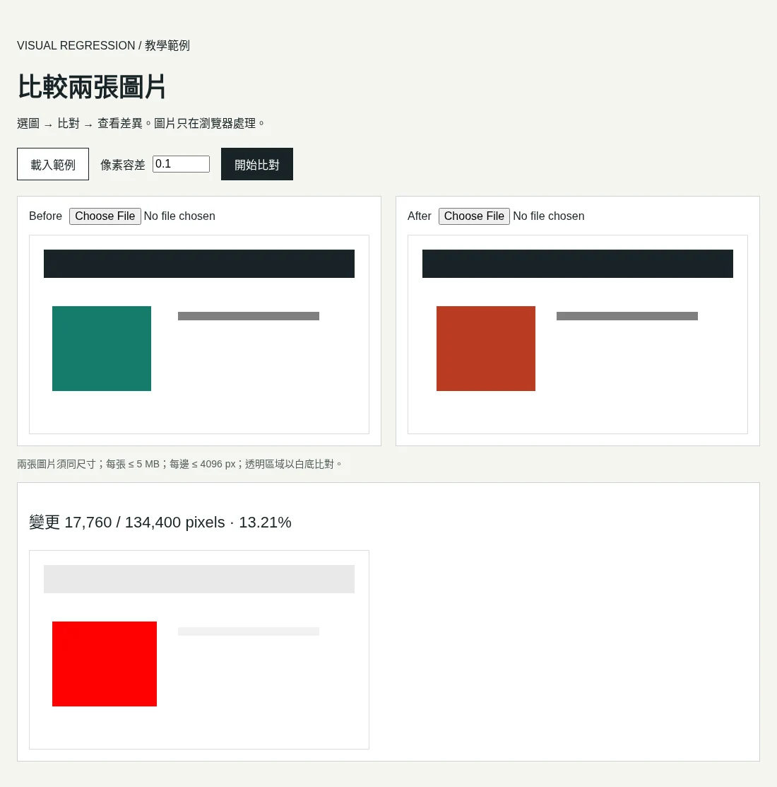

## 1. 在改程式前先錄一份

用前課的專案執行 `bun run dev`，先用內建圖記下 changed、total 和 threshold。要看執行緒，另準備兩張相同尺寸、部分內容相異的 2048 × 2048 PNG；也可在同一繪圖檔畫兩個不同位置的方塊，各存一張。打開 DevTools → Performance，按 Record，回頁面比對大圖，結果出來就 Stop。記下同組大圖的像素數，在 Main track 找對應的 click、compare 或 pixelmatch 呼叫。

## 2. 給 Worker 一個可傳遞的工作

[下載本系列實作附件](../../downloads/visual-regression-series.zip)。把 `patches/05-worker/src/lib/worker-types.ts` 與 `image-diff.worker.ts` 加到專案同名目錄，並用該目錄的 `run-compare.ts` 取代原同步版本。`diff.ts` 保持不動。打開 worker-types，看 job 的 id、a、b、threshold：這些值足以完成運算，沒有 DOM、File input 或 React state。

Worker 收到工作後執行原來的 `compare(a, b, threshold)`，再把結果送回。下列兩行位於 `image-diff.worker.ts`；沿用同一個演算法可讓前後兩次數值直接比較。

```ts
const reply: Reply = { id, result };
self.postMessage(reply, { transfer: [result.rgba.buffer] });
```

## 3. 在頁面啟動、交件、收尾

打開 `run-compare.ts`，找 `new Worker(new URL("./image-diff.worker.ts", import.meta.url), { type: "module" })`。相對路徑讓 bundler 可找到 worker 入口。接著找 `a.rgba.slice()` 與 `b.rgba.slice()`：傳出去的 buffer 會 detach，這裡先複製，讓 viewer 保有用來預覽及重新比對的原資料。成功、錯誤、abort 與逾時都會走 cleanup，呼叫 `worker.terminate()`。

以 2048 × 2048 RGBA 計算，每份陣列約 16 MiB。兩個原陣列再加兩份複本就約 64 MiB，尚未含輸出、解碼與 Canvas。畫面能繼續回應是分工帶來的收益，記憶體和整體時間仍要實際量。

## 4. 重錄並測一次中途換圖

執行 `bun run check` 再啟動 dev。使用同兩張大圖、容差和相同 CPU 設定重新錄 Performance；展開 Worker track，看比對工作是否移到該處。比對前後 changed、total、Diff 應相同。若輸出忽然歸零，先查傳出去的 buffer 是否已在上一次 transfer 後被清空。

回內建圖核對上方截圖。換回大圖開始比對，立刻換另一張 Before 或調整容差，舊結果應消失，而且等候中工作不得回頭蓋掉新畫面。`viewer.tsx` 的 AbortController 取消舊工作，revision 編號則擋住晚到結果。完成後接[一像素與兩帳號的驗收](../visual-regression-06-correctness-and-access/)。
