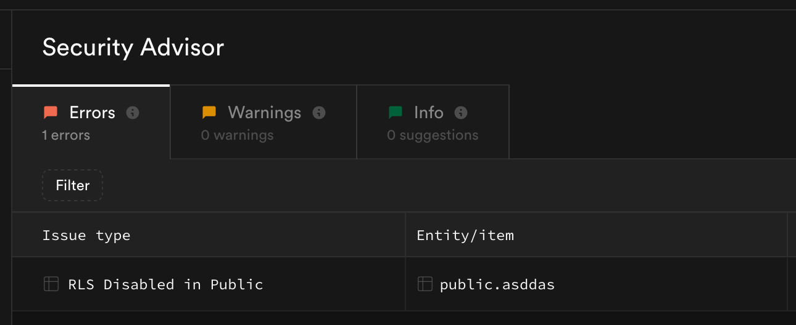

系列：[1 起步](../visual-regression-01-nextjs-bun-biome/) · [2 Vercel](../visual-regression-02-vercel-deploy/) · [3 Supabase](../visual-regression-03-supabase-private-storage/) · [4 Actions](../visual-regression-04-ci-cd/) · [5 Worker](../visual-regression-05-web-worker/) · [6 驗收](../visual-regression-06-correctness-and-access/)

[下載完整範例與圖片（ZIP）](../../downloads/visual-regression-series.zip) · [程式與驗證範圍](../../downloads/visual-regression-series/README.md)

本篇留下驗收紀錄：比對規則、登入隔離、私人圖片連結。

先完成第五篇，準備兩個教學 GitHub 帳號、分開的瀏覽器 profile 與色塊圖。教學版尚未實作分享、Server 重算與持久化 Cleanup Queue；後半篇是待辦，不是已完成操作。

## 1. 記下這次驗收條件

建立一份紀錄，填入：程式 SHA、Browser 版本、圖片尺寸、`threshold`、`includeAA`、背景色、pixelmatch 版本。

本教學以 sRGB PNG、白底、`includeAA: false` 為主要驗收條件。

## 2. 兩邊選同一張圖片

開教學頁，Before、After 都選同一個 PNG，再開始比對。

應看到零差異。這只代表目前解碼與演算法規則下沒有差異像素。

同一張 PNG 放在兩側的實際零差異結果。（本次實拍；[操作紀錄](../../downloads/visual-regression-series/sources/local-captures.json)）

## 3. 用已知差異檢查計算

準備兩張同尺寸 PNG，只把其中一張的一個黑色像素改為白色。用相同設定比對。

核對變更像素與比例。若數值不符，先檢查檔案尺寸、實際像素、解碼與容差，不手改結果。

## 4. 換成尺寸不同的圖片

Before、After 選不同尺寸的 PNG，再開始比對。

應拒絕計算並顯示尺寸錯誤；不自動縮放或對齊。

尺寸不同的實際拒絕畫面。（本次實拍；[操作紀錄](../../downloads/visual-regression-series/sources/local-captures.json)）

## 5. 檢查透明區域

用含透明像素的教學圖比對，觀察白底合成後的結果。

教學版比較白底上的外觀；只在其他底色出現的差異可能不會反映出來。

## 6. 調整容差

先保留原設定結果，再提高 `threshold`，重新比對。

容差控制單一像素的顏色差異；數值提高可能漏掉部分變化。`includeAA: false` 也會排除部分抗鋸齒邊緣。

## 7. 把其他圖片格式另列紀錄

若範例接受 JPEG、WebP，再使用已知尺寸的教學檔案測試；不接受的格式應明確拒絕。

有色彩描述、EXIF 方向或動畫的圖片，另訂規則。Browser 與未來 Server 解碼不一致時，要保留錯誤。

選不支援的檔案類型時，教學程式顯示錯誤。（本次實拍；[操作紀錄](../../downloads/visual-regression-series/sources/local-captures.json)）

## 8. 用帳號 A 儲存一筆

在第一個 Browser profile 登入教學帳號 A。

開 `/private`，載入色塊圖 → 比對 → 儲存比較 → 重新讀取歷史。

回 Supabase → Table Editor → `tutorial_comparisons`，找剛新增的紀錄；複製 `id` 與 `before_path`，僅供自己的權限測試。不要複製 Signed URL。

## 9. 登出後再開私人頁

登出 A，直接開 `/private`。

應回登入頁；不能顯示剛才的歷史或私人圖片。

## 10. 用帳號 B 查看歷史

在另一個 Browser profile 登入教學帳號 B，開 `/private`，重新讀取歷史。

不應看到 A 的紀錄。兩個 profile 分開，避免混用同一份 Session Cookie。

## 11. 直接請求 A 的資料

先停止 dev，建立 `src/app/access-check/`，將附件 [tools/access-check-page.tsx](../../downloads/visual-regression-series/tools/access-check-page.tsx) 複製為 `src/app/access-check/page.tsx`，再啟動 dev。

這個本機檢查頁沿用目前瀏覽器的登入 Session，直接呼叫資料表與 Storage API；不要求貼 Token，也不顯示 Signed URL。

先在 A 的視窗開 `http://localhost:3000/access-check`：

1. 輸入步驟 8 的紀錄 `id`。
2. 輸入同筆紀錄的 `before_path`。
3. 點「檢查目前權限」。
4. 確認已登入、資料表請求沒有錯誤，兩項「可取得」都是「是」。這是正向對照，先排除填錯路徑。

再在 B 的視窗開同一頁，填完全相同的兩個值，按相同按鈕。

預期仍是「已登入」，但資料列與新圖片連結均不可取得。最後登出，再按一次，兩項仍不可取得。資料表 SELECT 在 RLS 下可能回空陣列；不預設一定回 403。

如果 A 也無法取得，先查 ID、路徑、登入、Data API 與設定，不能把這次結果算成隔離通過。完成後刪除 `src/app/access-check/page.tsx`，不將本機檢查頁一起部署。

SQL Editor 的管理員查詢可能繞過 RLS，不能代替這一步。

[官方原圖](https://github.com/supabase/supabase/blob/7e866ef83e89e35cdda45a6c98abd069d5fa1b2f/apps/www/public/images/blog/2026/security-retro/security-advisors.png)

官方錯誤畫面：若教學資料表出現 RLS Disabled in Public，先修正 RLS，再做權限驗收。這不是本次資料庫的掃描結果。

## 12. 等圖片連結過期

以 A 取得自己的圖片連結，確認可開啟。等待超過程式設定的 60 秒，再以同一個 URL 發出新請求。

過期後不應再下載；回歷史重新取得連結後應能開啟。測試時避開瀏覽器已下載圖片的快取，不以畫面仍顯示判定連結有效。

## 13. 確認保存數值的限制

第三篇的教學版把 Browser 計算值寫進資料表。RLS 隔離使用者，不能證明使用者提交的數值正確。

若要把紀錄用於審核，下一版須由 Server 驗證身分與圖片所屬權、讀取實際圖片、檢查格式／容量／尺寸，再以同版演算法重算。只保存 Server 結果，另加頻率與用量限制。

這部分尚未實作，沒有可宣稱通過的 Server 核對畫面。

## 14. 分享功能先列驗收條件

教學版目前沒有分享按鈕。實作時，私人 Bucket 保持 Private，另建立分享授權：

1. 用 CSPRNG 產生 32 bytes Token；DB 只存 SHA-256 hash。
2. 每次開分享頁，Server 檢查 hash、期限與撤銷狀態。
3. 通過後才核發短效圖片 URL，例如 60 秒。
4. 分享頁設 `no-store`、`noindex`、`no-referrer`。

實作後再測：匿名可開有效分享；到期、撤銷後不再核發 URL；猜 ID 不可讀取。

撤銷後，已核發 URL 仍可能在到期前有效，也不能收回已下載圖片。若每次新請求都須立即檢查，改由 Server 代理讀取，另評估快取與傳輸成本。

## 15. 清理功能先列失敗情境

第三篇只在上傳階段失敗時嘗試刪除已回報成功的圖片；DB insert 的回應失敗可能已提交，因此保留原圖，等待後續核對。關頁、斷網或刪除失敗，仍可能留下孤兒檔。

下一版的實作順序：

1. 上傳前建立 Reservation。
2. 刪除資料時，在同一個 DB transaction 寫入 Cleanup Queue。
3. 背景工作透過 Storage API 刪檔。
4. 失敗保留工作，成功才完成；檔案已不存在可視為完成。

實作後分別測：第二張上傳失敗、DB insert 失敗、清理 API 失敗、同一工作執行兩次。

不要用 `DELETE FROM storage.objects` 代替 Storage API 刪檔。自動清理完成前，只放教學圖片。

## 16. 留下可重查的驗收紀錄

每項記錄輸入、設定、操作、實際回應、通過／失敗與截圖編號。分享、Server 重算、Cleanup Queue 標為「未實作」，不要填通過。

圖片轉 PNG 可以移除部分原檔 metadata，畫面中的文字仍會留下。截圖使用色塊與教學帳號；遮蔽須寫入匯出影像的像素，不能只在頁面疊黑色圖層。

真實跨帳號與 Storage HTTP 驗收仍待專用教學 Project 執行；不要把本機五項測試填成這些項目的通過結果。
