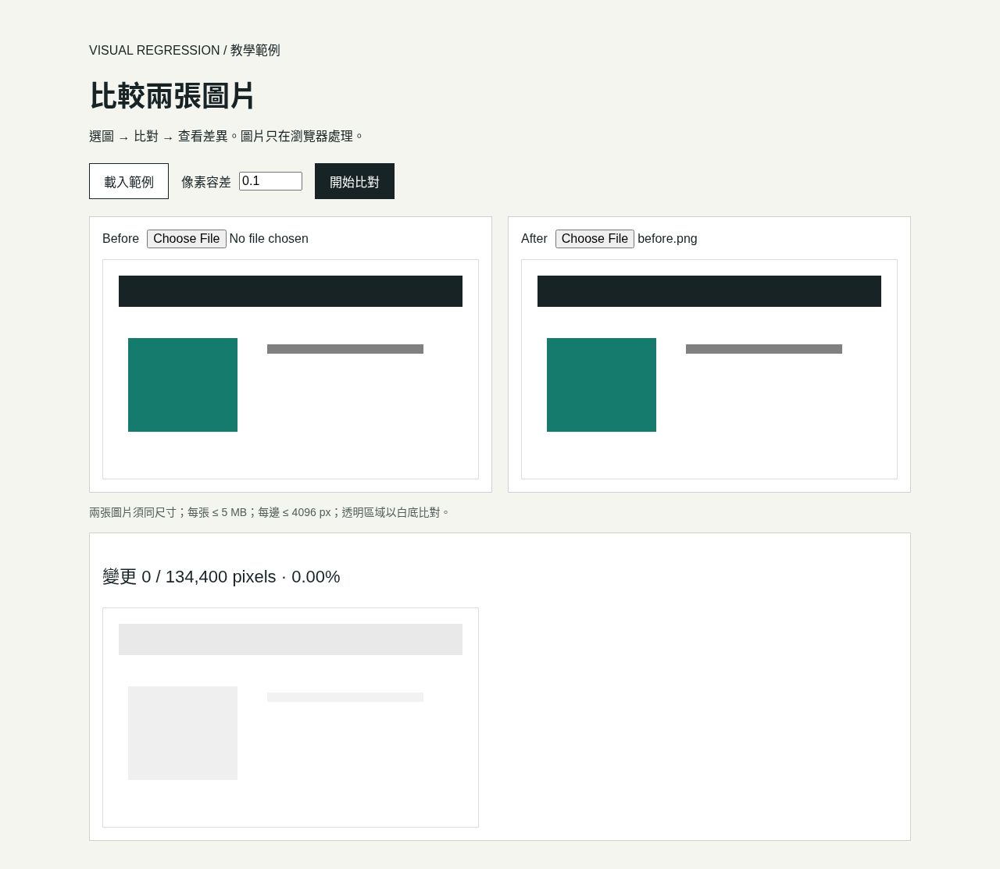
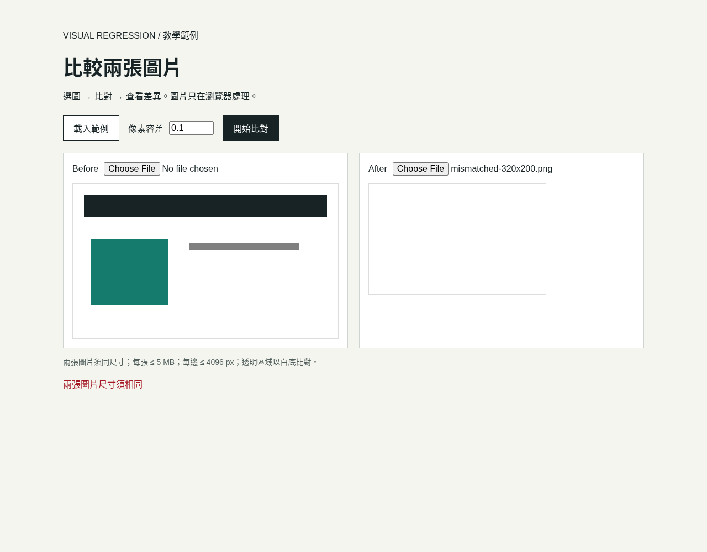

## 1. 先驗一個能手算的案例

打開 `tests/diff.test.ts`，複製「黑白一個像素」這個 test，命名為「相同黑色仍為零」。把兩邊都傳相同黑色，預期改為 0。下列是新增的完整測試，使用檔案已有的 imports、`Pixels` 型別與 `compare`。

```ts
test("相同黑色仍為零", () => {
  const black: Pixels = {
    width: 1,
    height: 1,
    rgba: new Uint8ClampedArray([0, 0, 0, 255]),
  };
  assert.equal(compare(black, black, 0.1).changed, 0);
});
```

在專案根目錄跑 `bun test tests/diff.test.ts`。原先五個測試加新案例應共六個通過。進首頁將同一張圖片各選一次；再換到不同尺寸樣本。前者要算出 0，後者要拒絕運算。這兩種情況在介面上要能分辨。





## 2. 先建立 A 確實讀得到的紀錄

用兩個獨立的瀏覽器 profile、兩個自己的測試 GitHub 帳號，以及[前篇設定好的 Supabase 專案](../visual-regression-03-supabase-private-storage/)。在本機教學應用以 A 登入 `/private`，載入範例、比對並儲存。去 Supabase Table Editor 找到剛新增的 `tutorial_comparisons`，複製該筆 id 與 before_path。

[下載本系列實作附件](../../downloads/visual-regression-series.zip)。將 `tools/access-check-page.tsx` 複製到本機 `src/app/access-check/page.tsx`，啟動 `bun run dev`。在 A 的視窗開 `http://localhost:3000/access-check`，貼上剛才兩項、按「檢查目前權限」。先看到 A 可取回自己的列及圖片連結，才換身分。

## 3. 對同一筆資料只改登入身分

在 B 的 profile 登入同一個本機站，再輸入 **A 的同一組 id 與 before_path**。最後在全新的未登入視窗重跑。頁面透過該視窗的正常 session 呼叫 Supabase，用結果分別檢查資料表和 Storage。避免在 Dashboard 裡代替這步，Dashboard 帳號與終端使用者權限不同。

| 測試身分 | 可取得 A 的資料列 | 可新建 A 圖片的 signed URL |
| --- | --- | --- |
| 擁有者 A | 是 | 是 |
| 另一個已登入帳號 B | 否 | 否 |
| 未登入 | 否 | 否 |

B 查詢可能成功但回空集合。匿名在範例的 GRANT 下可能收到權限錯誤。若 A 也取不到，先修復登入、路徑或 API 設定再重試；此時得不到的結果無法證明隔離有效。

## 4. 檢查連結時效與驗收紀錄

回 A 的私人頁重新讀歷史，選一筆已儲存的比對。先只複製 Before 連結，留到 60 秒過後再第一次開啟它；After 則立即開啟。前者可以檢查過期簽章在首次請求時是否遭拒，後者確認同一筆的圖片原本讀得到。開 DevTools 的 Network 看 HTTP 回應，記下實際狀態。

如果先開過圖片，再於 60 秒後重開同一個連結，瀏覽器或 Smart CDN 可能仍回傳快取的內容。簽章到期和清掉已有的快取是兩件事。測試 B 的身分時，要觀察 B 能否自己簽發 A 的連結；將 A 已取得的有效連結貼給 B，是另一種測試。[Supabase 對簽名網址與 CDN 快取的說明](https://supabase.com/docs/guides/storage/cdn/smart-cdn#signed-urls-and-cdn-caching)

把 commit、兩張圖、容差、實際觀察、檢查時間記進自己的驗收表。移除本機檢查頁，保留測試案例。此教材尚未實作分享撤銷與伺服器重算，這兩個項目另列。接著看[整條比對流程的分工與限制](../visual-regression-project-summary/)。
