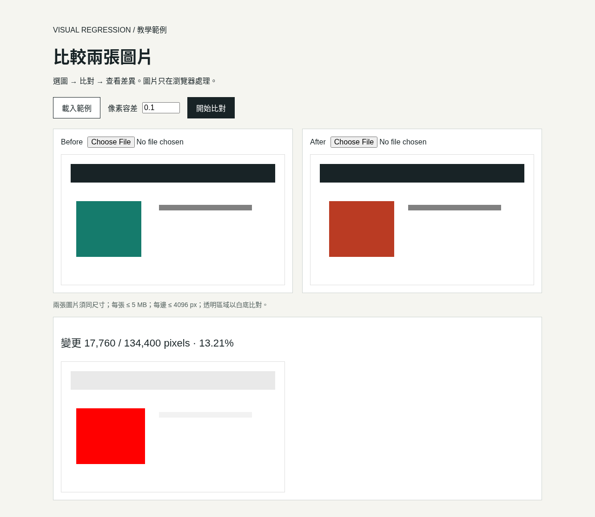

看下面兩張色塊，只靠前後切換，很容易漏看藍色方塊的位置變了多少。多放一張 Diff，就能圈出要審的位置。整套課從這個功能開始，到最後你會有自己的網址，可以登入、存圖，並驗證另一個帳號讀不到同一筆紀錄。

## 沿著一張圖片找程式的邊界

選圖時，React 只拿到 File。瀏覽器解碼它，Canvas 才能讀出每個像素的紅、綠、藍及透明度。兩張圖尺寸相同，pixelmatch 才能比較相同座標的顏色。這條路徑都在使用者的分頁內，第一個版本不需要帳號。

重新整理後還想看上次那一組，資料才需要離開分頁。練習用 Supabase Auth 記住是誰，私有 Storage 保存兩張圖，Postgres 記錄檔案路徑、容差、像素數。Next.js 負責 OAuth 回程與頁面，Vercel 提供可分享的部署網址。後面再用 Web Worker 把長時間的像素迴圈移出主執行緒。

## 你會自己做出哪些東西

| 做到這裡 | 手上可以驗收的東西 |
| --- | --- |
| [用 Next.js 接好比對器](../visual-regression-01-nextjs-bun-biome/) | 本機可選圖，內建樣本得到 17,760 個差異像素 |
| [從 GitHub 部署到 Vercel](../visual-regression-02-vercel-deploy/) | 別台電腦可開啟的 Production URL |
| [接 Supabase](../visual-regression-03-supabase-private-storage/) | OAuth 返回自己的頁面，重新整理可讀回個人紀錄 |
| [接 GitHub Actions](../visual-regression-04-ci-cd/) | 一次可辨識的失敗測試及修正後的綠燈 |
| [搬進 Worker](../visual-regression-05-web-worker/) | Diff 不變，Performance 可分辨工作在哪個執行緒 |
| [測正確性與存取範圍](../visual-regression-06-correctness-and-access/) | 固定輸入、預期輸出與兩個測試帳號的檢查結果 |

教學使用獨立的 `image-review`，附件附上三個階段的完整程式與鎖定檔。正式 Framecheck 的同步縮放、審核與分享等設計，另見[產品公開架構](https://visual-regression-hub.vercel.app/source)。[下載本系列實作附件](../../downloads/visual-regression-series.zip)。
