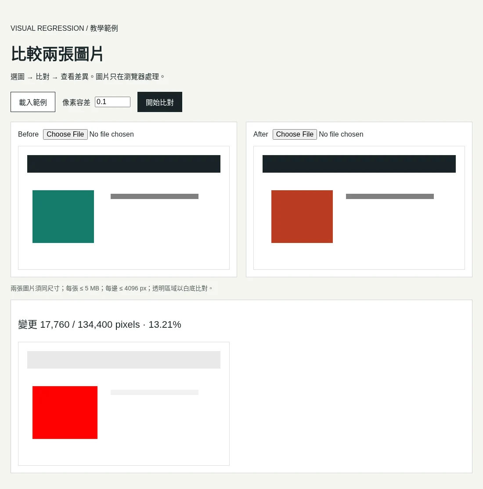

第一次看到色塊移動，肉眼只知道畫面不同。現在可以說出哪個輸入、哪個容差、哪個演算法得到 17,760 個不同像素，也能用同一組圖在主執行緒與 Worker 跑出相同結果。比例是後續審查的入口；要決定變動能不能接受，仍需要人看變動位置。

## 沿著一筆私人紀錄回頭查

| 問題 | 先看哪裡 | 可以得到的答案 |
| --- | --- | --- |
| 兩張看起來相同的圖，為什麼算出差異？ | read-image.ts、diff.ts | 解碼、白底合成、尺寸、threshold 和抗鋸齒設定 |
| 換圖後怎麼又出現上一組結果？ | viewer.tsx、run-compare.ts | 是否取消舊工作，以及晚到回應能否更新目前畫面 |
| 已登入卻找不到歷史？ | tutorial_comparisons、own_read | 列是否成功寫入、owner_id 是否與 session 相符 |
| 歷史可見但開不了圖？ | before_path、Bucket 與簽名時效 | 物件確實存在、路徑屬於這個帳號、連結仍有效 |
| 本機正常、正式站返回登入頁？ | Vercel 環境與 Supabase Redirect URLs | 新 build 是否帶入正式設定，以及回程 host 是否列入允許清單 |

## 哪些是練習結果，哪些要在自己環境確認

附件附有三個階段的[型別、測試與 build 紀錄](../../downloads/visual-regression-series/code/VERIFICATION.md)。Vercel Production 網址、OAuth 回程、兩帳號隔離和 Worker 所花時間取決於你自己的設定，應留下這次的觀察值，才知道下一次修改是否有退步。

練習版由瀏覽器提交 changed_pixels；RLS 能約束哪個人可寫，無法證明送出的數字真的來自那兩個檔案。若要把數值拿來當團隊核准的依據，下一步是讓伺服器讀回兩張原圖，以同版本解碼器與演算法重算，並處理存圖成功但資料列寫入結果不明的情況。只需要在自己機器比兩張圖，可以停在第一篇的本機版。

[回 Framecheck 系列目錄](../../series/visual-regression/)
