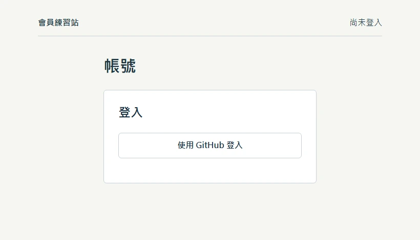

這個系列要做一個小會員頁。訪客按 GitHub 登入，回站後，頁首和帳號面板要同時認得他；重新整理後仍然認得。第二篇會把 React、Supabase Auth 和 GitHub OAuth 接起來，最後部署到 Vercel。

## 點一次登入，會經過哪幾層

| 位置 | 在這一層寫什麼 | 做完怎麼辨認 |
| --- | --- | --- |
| React | 用同一個 `AuthProvider` 包住 `AuthPanel` 和 `AuthStatus` | 畫面有 GitHub 按鈕及頁首狀態。 |
| 共用套件 | 用 `githubOnly` 設定 controller，把 Supabase client 的 `auth` 交給 adapter | 按鈕觸發的是 GitHub，回站網址是自己的首頁。 |
| Supabase Auth | 設定 GitHub provider、允許回站的 URL | 完成授權後可建立這個專案自己的 session。 |
| GitHub | 登記 OAuth App 和 Supabase 提供的 callback | GitHub 知道該把授權結果送到哪個服務。 |

為什麼要兩個網址？GitHub 驗證帳號後，先把結果交給 Supabase；Supabase 處理完再送回 React 網站。前一個是 GitHub OAuth App 的 **Authorization callback URL**，後一個是 Supabase 的 **Redirect URL**。串錯時，單看登入按鈕無法找到原因。

同一套元件也提供 Better Auth 與 Neon adapter。這個練習選 Supabase，因為瀏覽器可以透過它處理完整的 OAuth 往返，Vercel 只需供應靜態檔案。若原產品已有會員資料，換 UI 前要另外核對既有帳號與資料的歸屬；元件本身不搬資料。

[第二篇從建立練習專案開始，完成 Supabase、GitHub 和 Vercel 的設定。](../web-auth-02-github-panel/)
