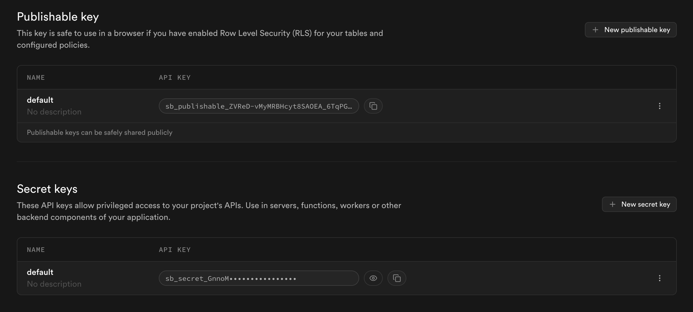
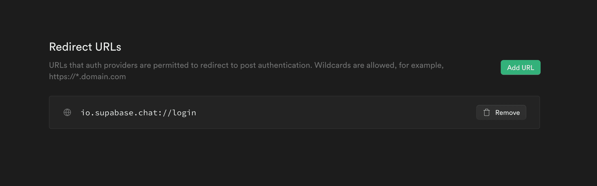
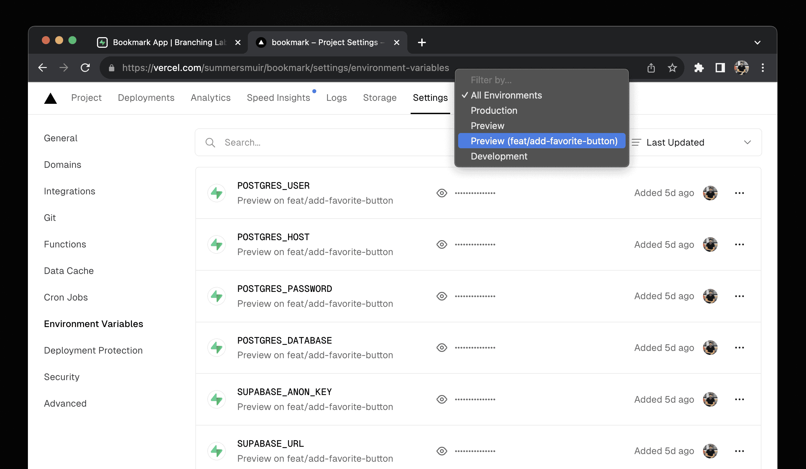

準備 GitHub、Supabase、Vercel 帳號，以及 Node.js 22.18+。我們用 Vite 建立只有一頁的會員站。所有回站網址都用首頁 `/`，先在本機跑通，再換上正式網域。

## 1. 在 Supabase 建立專案，找到第一個 callback

進入 Supabase Dashboard，選 **New project**，命名為 `auth-lab`。建立完成後，從專案的 **Connect** 取得 Project URL，到 **Settings → API Keys** 複製 **Publishable key**。兩個值稍後放進前端。資料庫密碼、secret key 和 `service_role` 都不用交給這個網頁。



開 **Authentication → Sign In / Providers**，選 **GitHub**，複製它顯示的 callback URL，通常長成 `https://<project-ref>.supabase.co/auth/v1/callback`。


## 2. 登記 GitHub OAuth App，再設定回站網址

1. 到 GitHub **Settings → Developer settings → OAuth Apps → New OAuth App**。填 Application name；Homepage URL 暫填 `http://localhost:5173/`。
2. 把**上一步從 Supabase 複製的完整 URL**貼到 GitHub 的 **Authorization callback URL**。註冊後複製 Client ID，產生一組 Client secret。
3. 回 Supabase 的 GitHub provider，啟用後填入這兩個值並儲存。Client secret 留在 Supabase。
4. 開 **Authentication → URL Configuration**。將 Site URL 暫設為 `http://localhost:5173/`，在 Redirect URLs 加入相同網址並儲存。若練習目標是服務端只接受 GitHub，也在測試專案關閉其他可用的登入方式。



## 3. 寫 React 頁面與 adapter

```sh
npm create vite@latest auth-lab -- --template react-ts
cd auth-lab
npm install
npm install @ntustray/web-authentication-component@0.3.0 @supabase/supabase-js@2.118.0
```

在根目錄新增 `.env.local`，把兩個示意值換成自己的公開設定。保持這個檔案在 Git 之外。

```dotenv title=".env.local"
VITE_SUPABASE_URL=https://YOUR-PROJECT.supabase.co
VITE_SUPABASE_PUBLISHABLE_KEY=sb_publishable_YOUR_KEY
```

新增 `src/auth.ts`。這個單頁網站會在同一個瀏覽器啟動並完成 PKCE 流程；回來後讓 Supabase client 辨識 URL 內的 code 並交換 session。Adapter 的 `callbackUrl` 是回到產品的位置。`recoveryUrl` 是介面要求的設定，GitHub-only 練習沒有開啟密碼重設。

```ts title="src/auth.ts"
import { createClient } from '@supabase/supabase-js';
import { createAuthController, githubOnly } from '@ntustray/web-authentication-component';
import { createSupabaseAdapter } from '@ntustray/web-authentication-component/adapters/supabase';

const supabase = createClient(
  import.meta.env.VITE_SUPABASE_URL,
  import.meta.env.VITE_SUPABASE_PUBLISHABLE_KEY,
  { auth: { flowType: 'pkce', detectSessionInUrl: true } },
);

const home = new URL('/', window.location.origin).href;
export const controller = createAuthController({
  methods: githubOnly,
  adapter: createSupabaseAdapter<'github'>(supabase.auth, {
    providers: ['github'],
    callbackUrl: home,
    recoveryUrl: home,
  }),
});
```

把 `src/App.tsx` 換成這個頁面。Controller 在 module 層建立一次。若兩塊 UI 各自建立 controller，登入後便容易出現面板已更新、頁首還顯示訪客的情況。

```tsx title="src/App.tsx"
import { AuthPanel, AuthProvider, AuthStatus } from '@ntustray/web-authentication-component/react';
import '@ntustray/web-authentication-component/styles.css';
import { controller } from './auth';

export default function App() {
  return <AuthProvider controller={controller} locale="zh-TW">
    <header><strong>會員練習站</strong><AuthStatus /></header>
    <main><h1>帳號</h1><AuthPanel /></main>
  </AuthProvider>;
}
```

要做出下圖的版面，把 Vite 預設的 `src/index.css` 換成這四條規則：

```css title="src/index.css"
:root { font: 16px/1.6 system-ui; color: #1f3540; background: #f5f6f2; }
body { max-width: 42rem; margin: 0 auto; padding: 2rem 1.25rem; }
header { display: flex; justify-content: space-between; align-items: center; border-bottom: 1px solid #ccd3d5; padding-bottom: .8rem; }
main { max-width: 26rem; margin: 2rem auto; }
```

執行 `npm run dev -- --port 5173 --strictPort`，開 `http://localhost:5173/`。如果連接埠已被使用，先關掉佔用服務，或同步修改 Supabase 允許的回站網址。


按 GitHub 登入，用測試帳號完成授權，應回到同一個本機網址。頁首和面板都應更新，重新整理仍須保有 session。若看到 GitHub 的 callback mismatch，回第 2 步檢查 GitHub 登記的 Supabase URL；若已授權卻回錯網站，先檢查 Supabase 允許的回站 URL。PKCE 需要原瀏覽器留存的 verifier，請在發起登入的瀏覽器完成流程。

## 4. 把同一頁部署到 Vercel

1. 跑 `npm run build`，確認產生 `dist/`。把專案放到自己的 GitHub repository，包含程式與 lockfile，排除 `node_modules`、`dist`、`.env.local`。
2. 在 Vercel 選 **Add New → Project**，匯入該 repository。Framework Preset 應為 **Vite**，Build Command 是 `npm run build`，Output Directory 是 `dist`。
3. 在 **Environment Variables** 新增與 `.env.local` 同名的兩個前端變數，套用至 Production，再選 **Deploy**。若部署後才加變數，選 **Redeploy** 讓 Vite 重新編譯。
4. 拿到固定的 Production 網址後，將 Supabase 的 Site URL 改成正式首頁，把完整 `https://你的網域/` 加入 Redirect URLs，保留本機那一筆。GitHub 的 Homepage URL 也可換成正式網址；它的 Authorization callback URL 繼續指向 Supabase。


看左側的 **Import Git Repository**。在這裡選自己的 `auth-lab`。右側紅框是官方圖片示範的範本，和這次匯入的專案無關。



用正式網址再跑一次登入、重整、登出，並核對授權後回到正式網域。這裡的元件截圖來自本課程式，Supabase 與 Vercel 設定圖沿用官方教學素材。不同帳號的真實授權結果，要用自己的測試帳號驗收。
