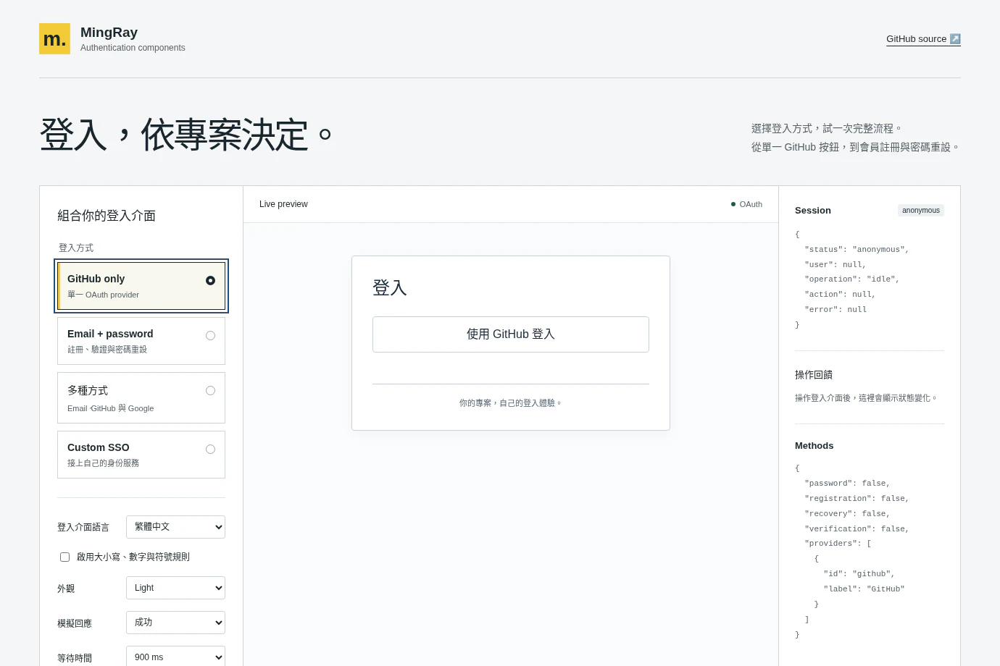
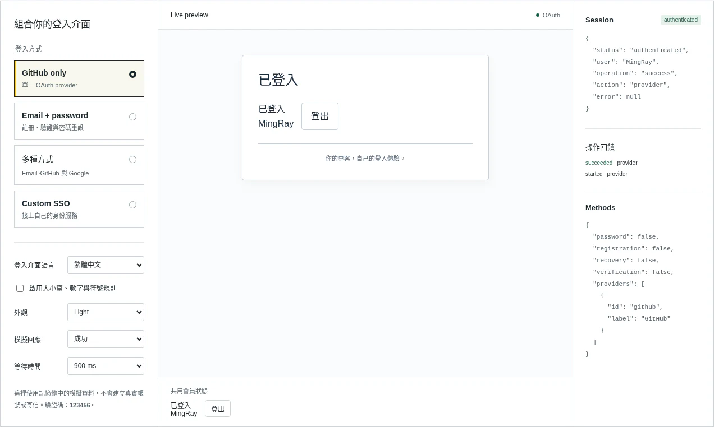
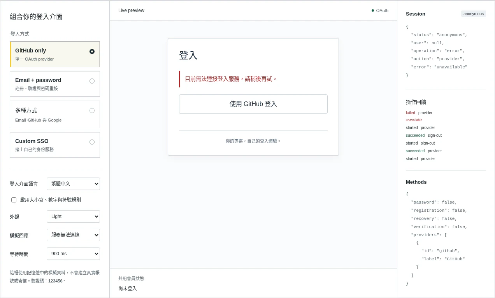

先在本機 Playground 看兩處登入狀態怎麼同步，再把相同的 React 組合接到已有的 Better Auth 服務。第一部分只需 Git、Bun 和 Node.js 22 或更新版本，也不需要 GitHub OAuth client ID。截圖以公開原始碼 `e5d66fb` 的 Playground 實際操作取得。

## 1. 跑公開 Playground

```sh
git clone https://github.com/ntustRay/web-authentication-component.git
cd web-authentication-component
git checkout e5d66fb9154c6c8aaa5bdb13982acd8429ce079f
bun install --frozen-lockfile
bun run dev
```

開啟終端機印出的本機 URL。在左側「登入方式」切到 **GitHub only**，保留「模擬回應」為「成功」。右側表單會只留下「使用 GitHub 登入」按鈕，Session 應顯示 `anonymous`。



## 2. 驗證同一個 session 更新兩個區塊

按「使用 GitHub 登入」。這裡的 demo adapter 會在瀏覽器記憶體建立一筆模擬 session。面板和「共用會員狀態」會一起顯示示範會員，Session 檢視區應變成 `authenticated`。



在「共用會員狀態」按「登出」，再確認面板回到登入按鈕。想對照失敗路徑時，把「模擬回應」改成「服務無法連線」，再按一次登入，確認畫面出現錯誤回饋且 session 維持未登入狀態。Playground 的 adapter 和帳號只用於本機展示。



## 3. 接到已有 GitHub provider 的 React 程式

這一步要有啟用 GitHub provider 的 Better Auth server、已登記的 OAuth 回呼 URL，以及專案自己的 `authClient`。下方假設登入頁為 `/login`，client module 和這個元件在同一目錄。

```sh
npm install @ntustray/web-authentication-component@0.3.0
```

```tsx title="Login.tsx"
"use client";

import { useState } from "react";
import {
  createAuthController,
  githubOnly,
} from "@ntustray/web-authentication-component";
import { createBetterAuthAdapter } from "@ntustray/web-authentication-component/adapters/better-auth";
import {
  AuthPanel,
  AuthProvider,
  AuthStatus,
} from "@ntustray/web-authentication-component/react";
import "@ntustray/web-authentication-component/styles.css";
import { authClient } from "./auth-client";

export function Login() {
  const [controller] = useState(() =>
    createAuthController({
      methods: githubOnly,
      adapter: createBetterAuthAdapter(authClient, {
        providers: ["github"],
        callbackUrl: "/",
        errorCallbackUrl: "/login?error=oauth",
        recoveryUrl: "/login",
      }),
    }),
  );

  return (
    <AuthProvider controller={controller} locale="zh-TW">
      <AuthStatus />
      <AuthPanel />
    </AuthProvider>
  );
}
```

若導覽列與面板位於不同路由，把 provider 移到兩者共用的 client layout，再把 `AuthStatus` 放進導覽列。GitHub OAuth App 登記的是認證服務的 callback URL。上面 adapter 的 `callbackUrl` 則是登入完成後回到產品的目的地。

最後在測試環境用測試帳號登入、重整並登出。確認頁面回到預期位置，面板和導覽列讀取同一份 session。另試一次取消授權，確認回到登入頁後可重新操作。上面的截圖記錄的是 Playground 的狀態同步和錯誤回饋。真實 OAuth 的跳轉和 cookie 要在自己的服務環境驗收。

[下一篇｜認證與資料授權要分開驗收](../web-auth-03-identity-boundaries/)
