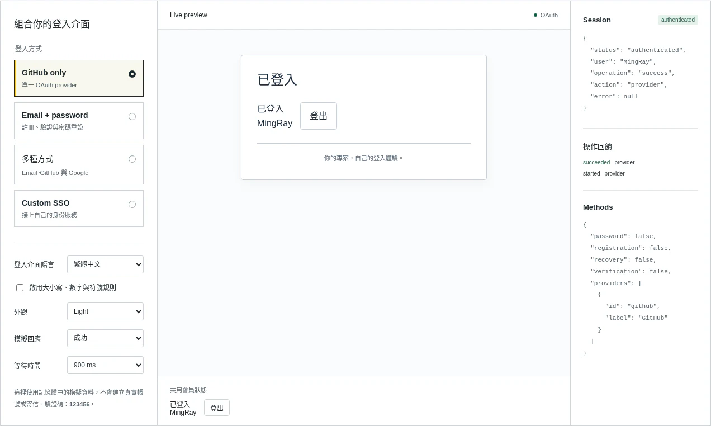

回頭看會員練習站，程式碼很短，是因為工作分得清楚。GitHub 確認帳號，Supabase 接收回呼並建立 session，React 的兩個元件從同一個 controller 讀結果。Vercel 供應編譯完成的網頁，沒有持有 GitHub Client secret。

## 把哪一段壞掉說清楚

| 實際結果 | 優先核對 |
| --- | --- |
| 按登入就報 provider 未啟用 | 登入按鈕、adapter、Supabase 後台是否都選 GitHub。 |
| GitHub 完成授權，卻回到錯誤網站 | GitHub 登記的是 Supabase callback；Supabase allowlist 和 React callback 選的是正確產品網域。 |
| 回站會登入，重新整理又顯示未登入 | 是否在原來的 origin 與瀏覽器完成登入、重新整理後的 client 是否連同一個專案。 |
| 面板顯示會員、導覽列仍是訪客 | 兩者是否在同一個 `AuthProvider` 下，使用同一個 controller。 |
| 從 A 換成 B，畫面還留著 A 的資料 | 產品端是否清掉使用者專屬查詢快取，資料 API 是否驗證當下的身份。 |

## 共用元件能驗到哪裡

第二篇的練習沒有私人資料表，所以它能驗收 OAuth 往返與 session 顯示。等產品要顯示「我的文件」，再加入一個屬於帳號 A 的測試文件。用 A 登入時應看得到，從同一分頁登出再以 B 登入，清單不得出現 A 的文件；API 或資料庫也必須依當下的使用者授權。只把按鈕隱藏，無法提供這項保證。

改用另一個認證服務時，可以保留 `AuthPanel`、`AuthStatus` 與這張驗收表。需要重做的是 adapter 配置、provider 的設定與回呼，以及產品真正依賴的資料權限。套件 Playground 中的成功和錯誤畫面適合檢查介面狀態，完整回呼仍要在自己的測試站跑一次。
