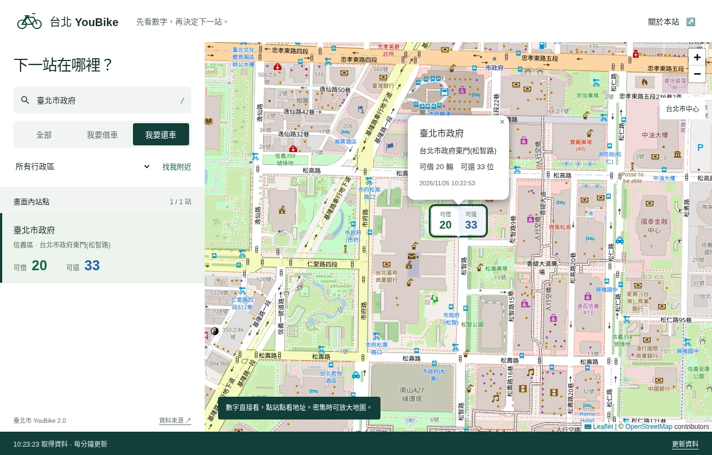

臺北市政府站有 20 輛可借、33 個空位可還。兩個數字同時出現在地圖上，準備出發的人和快到站的人各看一個。把同一個站畫成一個綠點，兩種情境就很難分辨。

圖中數值屬於截圖當下。這個系列會從空資料夾寫出自己的信義區小地圖，先用兩筆固定資料釐清三件容易弄錯的事，再換成即時來源。

| 收到什麼 | 畫面該怎麼說 | 原因 |
| --- | --- | --- |
| `available_rent_bikes: 0` | 可借 0 | 站點真的沒有可借車輛 |
| 還車欄位沒有值 | 可還 — | 缺值不能證明空位已滿 |
| `infoTime` 與按更新的時間不同 | 保留站點回報時間 | 瀏覽器剛拿到的回應也可能包含舊資料 |

資料分成兩條路。瀏覽器向市府的 JSON 取站名、數量與座標，再把座標交給 Leaflet。底圖則來自 OpenStreetMap 的圖磚。站點清單正常、地圖只剩空白方格時，可以分別檢查這兩種 Network 請求。

第二篇會完成可獨立執行的清單和失敗提示；第三篇替相同資料加上地圖，部署到自己的 Vercel 網址。這個練習只顯示最新狀態，用靜態檔案便能完成。要回答「昨天早上八點有幾台車」，才需要定時收集歷史資料與資料庫。
