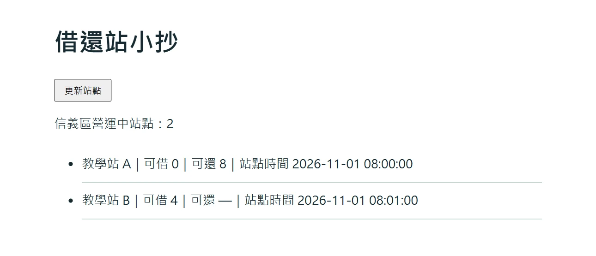
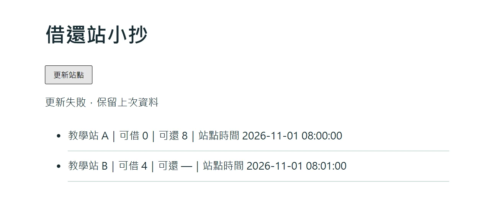

先把第一站的可借數設成 0，第二站的可還數留空。跑完這課，你的瀏覽器應該顯示兩筆，第一列寫「可借 0」、第二列寫「可還 —」。兩站都是練習資料，方便每次修改得到相同結果。



## 1. 建站點資料和單頁入口

裝好 Python 3，新增資料夾 `youbike-lab`。在資料夾內新增 `stations.json` 並貼上這兩站。欄位保留政府 feed 的命名，第三篇畫地圖會用到經緯度。

```json
[
  {"sno":"A","sna":"YouBike2.0_教學站 A","sarea":"信義區","act":"1","available_rent_bikes":0,"available_return_bikes":8,"latitude":25.0408,"longitude":121.5668,"infoTime":"2026-11-01 08:00:00"},
  {"sno":"B","sna":"YouBike2.0_教學站 B","sarea":"信義區","act":"1","available_rent_bikes":4,"available_return_bikes":null,"latitude":25.0380,"longitude":121.5660,"infoTime":"2026-11-01 08:01:00"}
]
```

新增同層的 `index.html`。更新按鈕、狀態訊息和清單分開，待會請求失敗時，只要改狀態訊息就能留下上次的清單。

```html
<!doctype html>
<html lang="zh-Hant">
<meta charset="utf-8">
<meta name="viewport" content="width=device-width,initial-scale=1">
<title>借還站小抄</title>
<style>
  body { max-width: 44rem; margin: 2rem auto; padding: 0 1rem; font: 18px/1.6 system-ui; color: #172b32; }
  li { padding: .7rem 0; border-bottom: 1px solid #b9cecd; }
  button { padding: .4rem .8rem; }
  #map { height: 340px; }
</style>
<h1>借還站小抄</h1>
<button id="refresh">更新站點</button>
<p id="status" role="status">等待資料</p>
<ul id="stations"></ul>
<script type="module" src="./app.js"></script>
</html>
```

## 2. 把 JSON 接到畫面

新增同層的 `app.js`。先取資料、檢查 HTTP 狀態、挑出信義區營運中的站，最後才呼叫 `render` 一次換掉清單。站名和時間透過 `textContent` 填入文字。

```js
const source = './stations.json';
const button = document.querySelector('#refresh');
const status = document.querySelector('#status');
const list = document.querySelector('#stations');
let loaded = false;

function count(value) {
  return Number.isInteger(value) && value >= 0 ? value : '—';
}

function render(stations) {
  const items = stations.map(station => {
    const item = document.createElement('li');
    item.textContent = station.sna.replace(/^YouBike2\.0_/, '') +
      '｜可借 ' + count(station.available_rent_bikes) +
      '｜可還 ' + count(station.available_return_bikes) +
      '｜站點時間 ' + (station.infoTime || '未知');
    return item;
  });
  list.replaceChildren(...items);
}

async function refresh() {
  if (button.disabled) return;
  button.disabled = true;
  try {
    const response = await fetch(source, { cache: 'no-store' });
    if (!response.ok) throw Error(String(response.status));
    const rows = await response.json();
    if (!Array.isArray(rows)) throw Error('格式錯誤');
    const stations = rows.filter(row => row && row.sarea === '信義區' &&
      String(row.act) === '1' && typeof row.sna === 'string');
    render(stations);
    loaded = true;
    status.textContent = '信義區營運中站點：' + stations.length;
  } catch {
    status.textContent = loaded ? '更新失敗，保留上次資料' : '無法載入站點';
  } finally {
    button.disabled = false;
  }
}
button.addEventListener('click', refresh);
refresh();
```

在這三個檔案所在目錄啟動本機伺服器。Windows 也可以使用 `py -m http.server 8000`。

```sh
python3 -m http.server 8000
```

打開 `http://localhost:8000`，對照頁首截圖。若完全沒有列，先確認瀏覽器網址以 HTTP 開頭，再到 Network 找 `stations.json`。若回傳 200 但畫面仍顯示「無法載入站點」，檢查 JSON 最外層的中括號與逗號。

## 3. 讓第二次請求失敗

保持分頁開著，把 `stations.json` 暫時改名成 `stations-away.json`，再按「更新站點」。伺服器回 404，兩筆站點應繼續顯示。把檔名改回原名後再按一次，應回到「信義區營運中站點：2」。



最後將 `app.js` 第一行的 `'./stations.json'` 改成下面的 JSON 網址，重整後就會看到真實信義區站名。資料集網頁提供欄位說明，程式要連的是 JSON 檔。要再跑固定測試，把來源改回去即可。

```text
https://tcgbusfs.blob.core.windows.net/dotapp/youbike/v2/youbike_immediate.json
```
