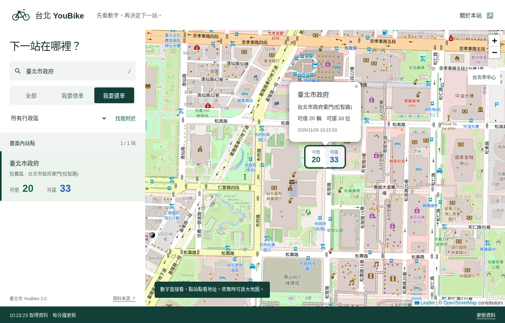
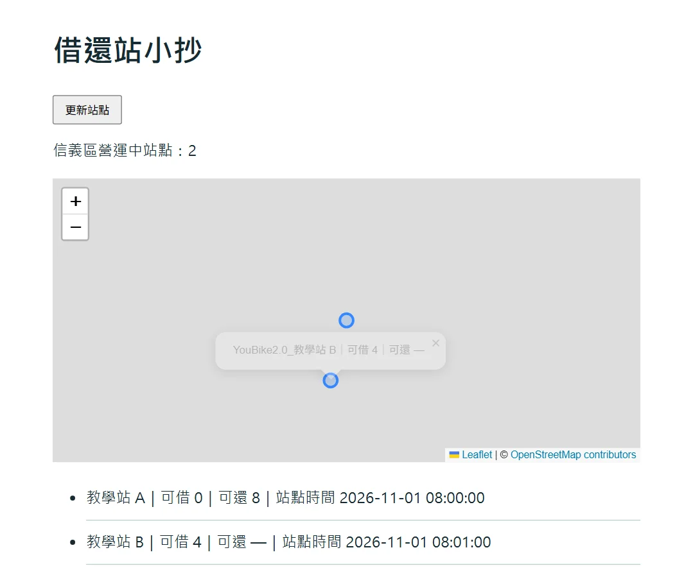

沿用上篇的三個檔案。先把來源切回 `./stations.json`，這樣兩個站會固定出現在臺北市政府附近，放大或點錯地方都能重來。

## 1. 放底圖容器，先確認地圖高度

在 `index.html` 的 `<ul id="stations">` 前插入以下三行，原本載入 `app.js` 的 module script 留在最後。上一課的 `#map` 已設定高度；若漏了，Leaflet 容器會縮成零高。

```html
<link rel="stylesheet" href="https://unpkg.com/leaflet@1.9.4/dist/leaflet.css">
<div id="map" aria-label="信義區借還站點地圖"></div>
<script src="https://unpkg.com/leaflet@1.9.4/dist/leaflet.js"></script>
```

在 `app.js` 最前面加入地圖初始化與畫點函式。底圖只初始化一次。站點每次成功更新才清掉重畫，連續按更新也不會長出重複的點。

```js
const map = L.map('map').setView([25.0408, 121.5668], 15);
L.tileLayer('https://tile.openstreetmap.org/{z}/{x}/{y}.png', {
  maxZoom: 19,
  attribution: '&copy; <a href="https://www.openstreetmap.org/copyright">OpenStreetMap contributors</a>'
}).addTo(map);
const points = L.layerGroup().addTo(map);

function drawMap(stations) {
  points.clearLayers();
  for (const station of stations) {
    const lat = station.latitude, lng = station.longitude;
    if (!Number.isFinite(lat) || !Number.isFinite(lng)) continue;
    const label = document.createElement('span');
    label.textContent = station.sna + '｜可借 ' + count(station.available_rent_bikes)
      + '｜可還 ' + count(station.available_return_bikes);
    L.circleMarker([lat, lng], { radius: 8 })
      .bindPopup(label).addTo(points);
  }
}
```

## 2. 讓清單和地圖吃同一批資料

在 `refresh()` 找到 `render(stations);`，下一行加上 `drawMap(stations);`，存檔後重整。點兩個圓點，應分別看到教學站 A 和 B。把 `source` 改回市府的即時 JSON，地圖應出現更多站。公開成品另外在 marker 本身就畫出兩個數字，下圖是它和本課簡版的差異。



再到 DevTools 的 Network request blocking 暫時封鎖 `*tile.openstreetmap.org/*`，重整並點教學站 B。地圖背景會變灰，但清單與兩個圓點仍在；popup 應顯示「可借 4｜可還 —」。取消封鎖再重整，底圖會重新載入。這樣可以分開驗證地圖座標、站點資料和圖磚三條路徑。



如果只看見底圖，先檢查 JSON 請求和清單。若清單已有站名，確認經緯度是數字，Leaflet 的順序是 `[緯度, 經度]`。

## 3. 將三個檔案部署到 Vercel

1. 在自己的 GitHub 建立空 repo，把 `index.html`、`app.js`、`stations.json` 放在根目錄。先點 GitHub 上的 `index.html` 確認沒有多包一層資料夾。
2. 在 Vercel 開啟 **Add New → Project**，選自己的 GitHub repo，按 **Import**。下圖是共用的官方操作示例，選擇你剛建立的 repo。


3. Framework Preset 選 **Other**，Root Directory 指到放 `index.html` 的目錄。這個專案沒有編譯或套件安裝步驟，保持 Build Command 空白，Output Directory 指向 `.`。按 **Deploy**，等狀態變成 Ready 再開分配的網址。


4. 在部署網址開 DevTools，檢查 `app.js`、市府 JSON、圖磚三種請求。點一個站核對 popup 和清單，再阻擋站點 JSON 並按更新，先前的圓點和清單應繼續顯示。若首頁 404，先查該次部署的 Output Directory 裡是否有 `index.html`。
