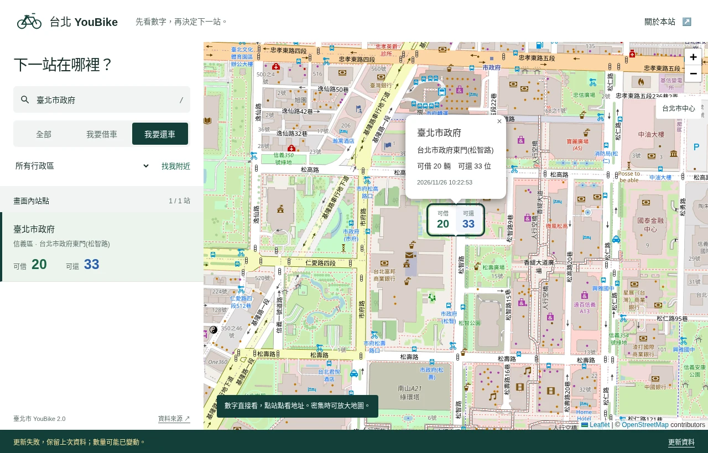

完成部署後，載入清單和點開 popup 只能證明順利取得資料時能畫出站點。對正準備還車的人，另外兩件事同樣重要：站點最後何時回報，以及剛才按更新有沒有成功。

| 怎麼重現 | 應看到什麼 | 若結果不符，先查哪裡 |
| --- | --- | --- |
| 用教學 fixture 載入 A、B 兩站 | A 可借 0；B 可還 — | 數量格式化是否把 null 轉成 0 |
| 已出現站點後阻斷 JSON 再更新 | 顯示更新失敗，上一批站點仍在 | 是否在收到成功回應前就清掉圖層 |
| 第一次開頁就阻斷 JSON | 顯示無法載入，無上一批資料 | 是否把初次失敗寫成保留舊資料 |
| JSON 正常，只擋圖磚網域 | 清單仍可查站名，底圖缺失 | 圖磚和站點是否共用錯誤狀態 |

簡版每次成功都重建信義區圓點；範圍夠小，程式很容易檢查。公開成品需要同時容納全市站點，會保留資料、只為可視範圍建立 marker，也能重用相同站點 ID。要判斷是否值得在自己的版本加入這層複雜度，可以固定同一份 JSON 與地圖範圍，在 DevTools 的 Performance 錄一輪拖曳，再看花在建立 marker 和重新排版的時間。

另外，畫面裡收到資料的時間與 `infoTime` 各有用途。前者可找出下載是否停止，後者才告訴你那一站的來源有多舊。即使兩個都新，也無法保證你走到站時還有位子。這也是成品把借還數、站點時間與鄰近備案放在一起的原因。
